# ECSP 通信机制图解

本文件把 [`ecsp-spec.md`](ecsp-spec.md) 里的运行机制画成图。图只帮助阅读，不另立规则；与规范正文不一致时，以规范正文为准。

覆盖范围是链路行为：寻址、帧与校验、请求应答、收帧判定、会话与事务、握手、事务序号、长耗时命令、复位、低功耗、上传模式、心跳、掉线、故障上报，以及主机看到应答码之后做什么。命令载荷的逐字段定义仍以规范第 5 章为准。

各从机的会话状态、事务状态、重发计数和会话建立计时相互独立。重发次数是事务上的计数器，不是一个状态。

## 1 机制怎么串在一起

正常通信建立之后，主机的请求和从机的主动上报是两条路。掉线、复位和会离开低功耗的握手，都要回到握手再核对版本。

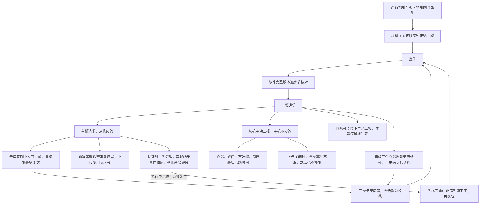

从请求分出去的事务序号、长耗时和重发，是不同命令各自用到的机制，不是每一条命令都走完。低功耗本身保持“正常通信”。只有退出命令得到成功应答、握手被受理，或会话因复位、重新握手重建之后，心跳和掉线判定才恢复。

## 2 角色与寻址

一条链路上一主多从。主机发起请求并管理链路，从机应答。从机之间不直接通信。同一节点可以在一条链路上作主机，在另一条链路上作从机，角色由产品规范按链路声明。

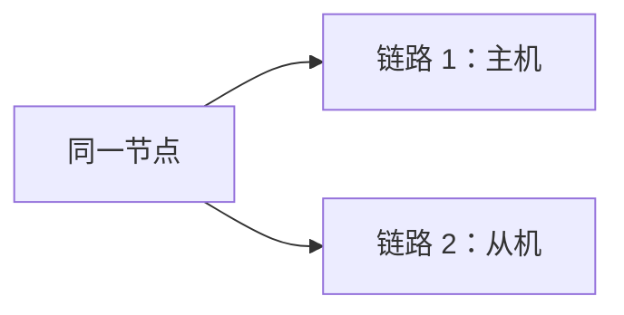

受理键是 **（产品地址，板卡地址）**。两个字段同时匹配本节点才受理；否则丢弃，无动作，也无应答。它排在 CRC 检查之后，完整顺序见第 7 节。

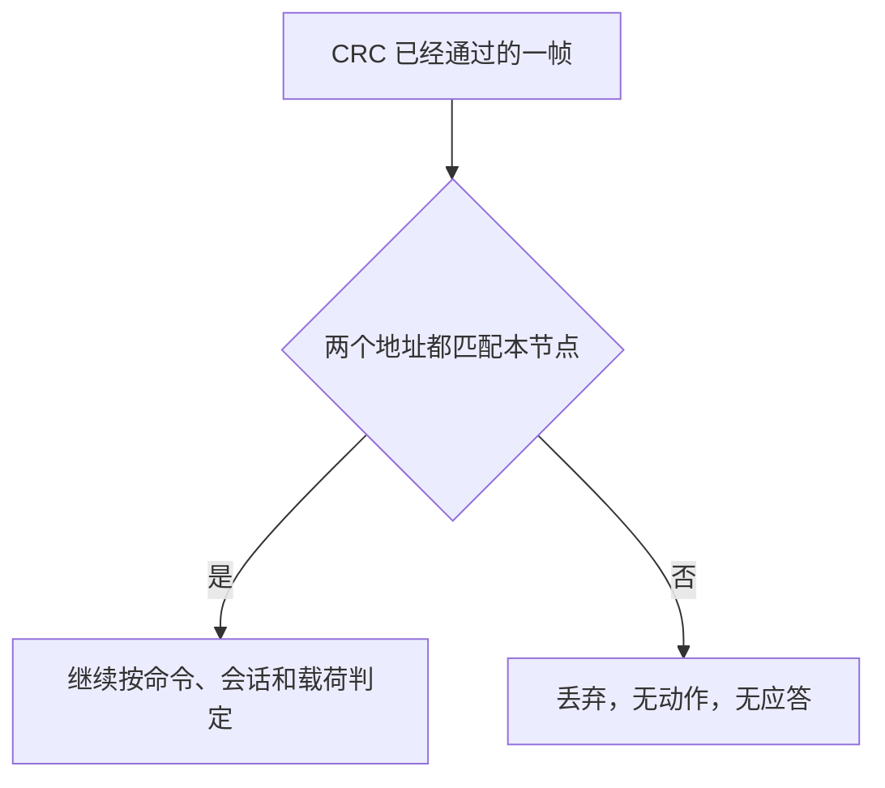

## 3 帧、校验与命令空间

字节按发送顺序排列。帧长度和帧校验都是小端。多字节整数、浮点数也默认小端：无符号数用原码，有符号数用补码，浮点数用 IEEE 754 单精度。字符串默认是定长 ASCII，帧内不含 `0x00`；只有命令自己声明变长时，才以 `0x00` 结尾。


CRC16-MODBUS 覆盖帧长度的第一个字节到数据载荷的最后一个字节。帧头、帧校验字段本身、帧尾都不在覆盖范围内。


命令码分区：


板卡功能命令复用本章的请求应答、应答码、事务序号、长耗时和主动上报规则，不得另立一套。

## 4 帧类型与命令类别

帧类型决定谁发起、要不要应答。命令类别决定做什么、重复执行是否安全。

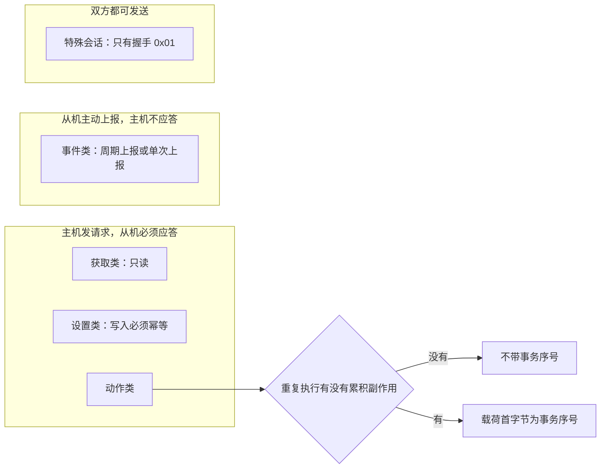

握手里，主机下发的请求必须应答；从机周期上报的那一帧，主机不应答。

## 5 请求、应答与超时重发

应答时限从请求帧发送完成起算，到应答帧开始发送为止。时限内没有合法应答，就重发同一帧。含第一次发送，最多 3 次。

对端把 CRC 错误或地址不匹配的帧静默丢掉，发送方只能看到超时。链路故障是另一件事：本端根本没有把整帧交给链路，事务不得进入等待应答。

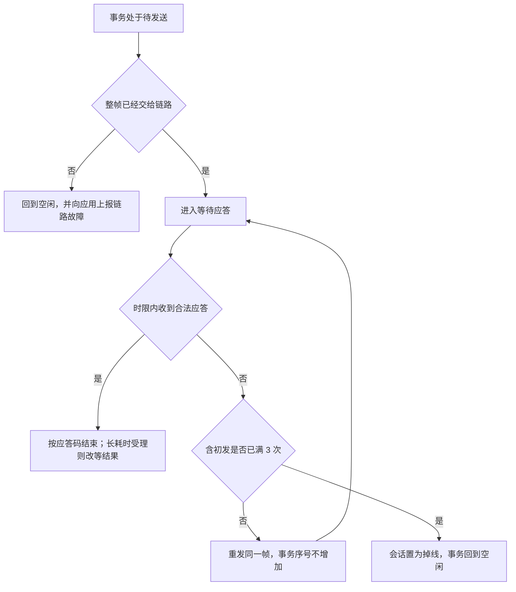

事件帧没有这一套重发。主机不应答，从机也不因没有应答而重传。

非易失写入单独放宽时限，并且这段等待不被 3 秒掉线判据截断，见第 6 节。

## 6 应答时限怎么选

获取类、设置类、动作类和握手共用一个默认值：不超过 50 ms。只允许放宽。放宽某一条命令时，这个默认值和其它命令都不变。板卡功能命令没有写明毫秒数时，用这 50 ms；写明了就只属于那一条命令。

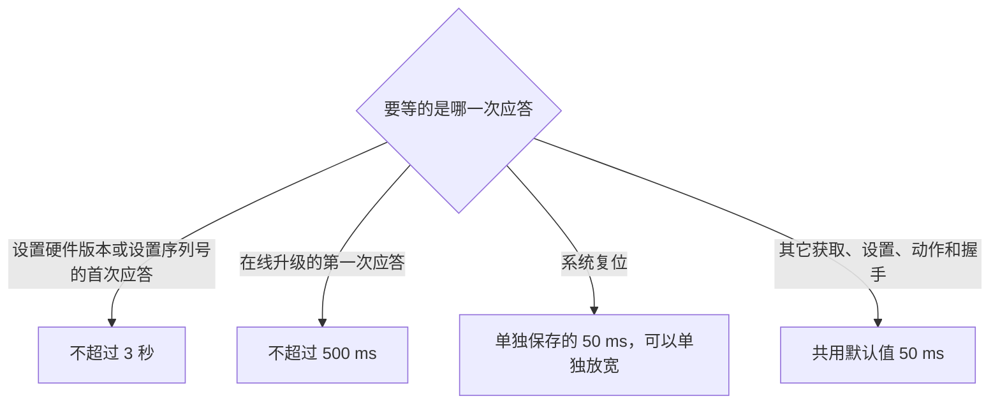

`0x03` 和 `0x05` 必须等身份提交有了结果才应答。格式或取值不合法时应答 `0x02` 或 `0x03`，已保存的身份保持原样。提交失败应答 `0x01`，已保存的身份同样保持原样。成功应答 `0x00` 只出现在已经持久化之后。擦除花了大约 2 秒、但未满 3 秒就应答，仍算成功；应答一到，主机立刻结束事务。满 3 秒还没有应答，才按第 5 节重发。含初发共 3 次，这三次等待都不被第 17 节的 3 秒掉线判据提前截断。三次仍然没有应答，事务超时，会话进入掉线。

## 7 从机收帧判定顺序

判定顺序固定。命中某一步就在那一步结束，后面的步骤不再做。顺序来自规范 4.1.2 所指向的 [ADR-0002](../adr/0002-slave-command-pipeline-order.md)。

缓存命中必须排在“忙”之前。长耗时命令的启动帧如果迟到重传，从机回放已经缓存的受理应答，不得再启动一次，也不得因为还在执行就改答 `0x11`。

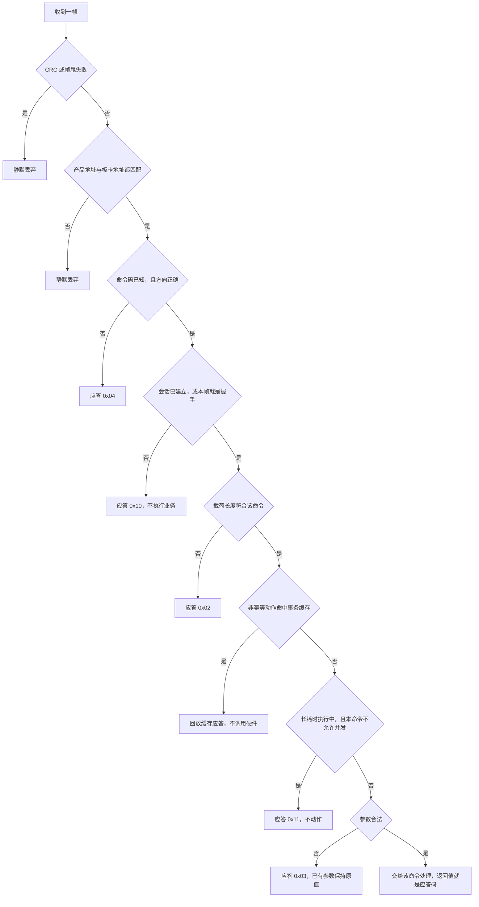

未定义命令先答 `0x04`，再谈有没有握手。设置类命令被拒绝时，它涉及的配置全部保持原值，不得只写成一部分。没有事务序号的命令不会命中缓存，直接进入下一步。

## 8 主机为每台从机记的两条状态

会话状态管这条会话还在不在、能不能下业务命令。事务状态管当前这一笔请求走到哪。同一台从机可以处在“正常通信”，同时事务处在“等待结果”。

### 8.1 会话状态

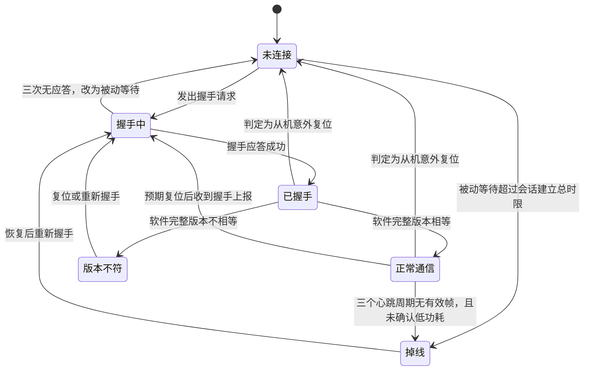

“版本不符”期间不得下发业务命令。掉线恢复后不得直接恢复业务，必须重新握手并再次核对版本。三个心跳周期无有效帧这条不限于正常通信；版本不符期间从机若沉默，同样掉线。图里只画了正常通信上的那一条。

已确认的低功耗仍算“正常通信”，这段沉默不走进掉线。意外复位时，规范 4.1.4 先把会话记为“未连接”，紧接着发出的握手请求再把它置为“握手中”；规范 4.4 把同一次接纳直接记为迁入“握手中”。两条说的是这一次重建的前后半段。

任一请求按第 5 节用尽三次发送仍无应答，会话也置为掉线，事务回到空闲。

### 8.2 事务状态

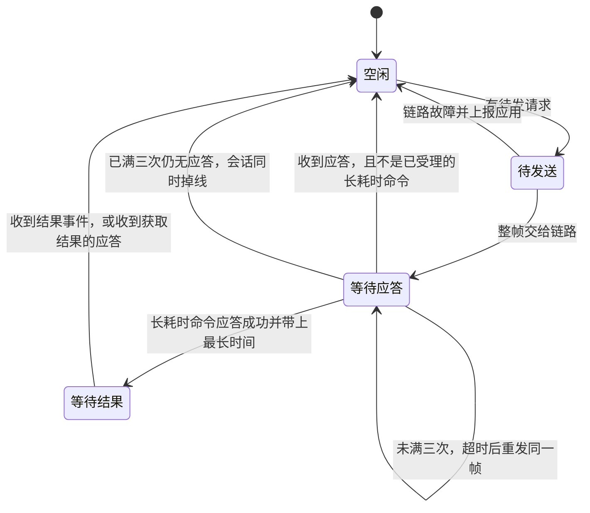

获取结果是这一笔长耗时事务的兜底，不另占一条事务，往返期间仍停在“等待结果”。它的应答一旦到达，事务回到空闲。若结果仍是正忙，停止命令是下一笔事务，并且使用新的事务序号。

## 9 从机上电后的会话

从机完成初始化、自检并具备通信能力后进入等待握手，以 1 Hz 发送握手上报，直到被接纳。推荐在上电后 500 ms 内具备这个能力，产品可以覆盖。

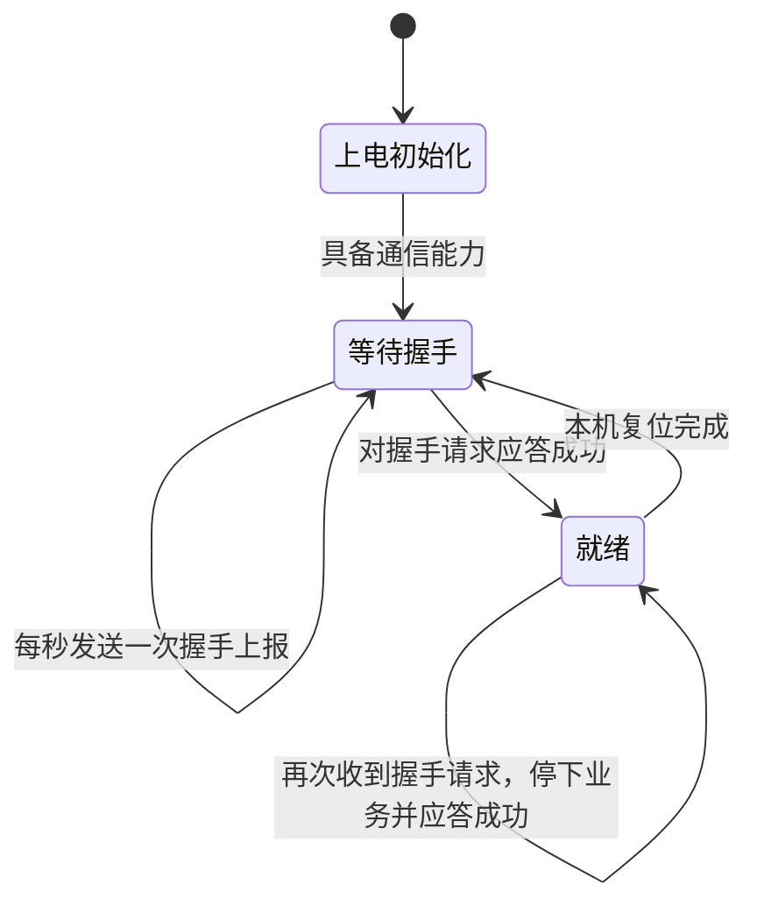

应答成功后进入就绪，并停止周期握手上报。事务缓存在收到握手请求时清空。已经就绪后再收到握手请求，判定主机意外复位：停下正在执行的业务，应答成功，保持就绪，不再恢复周期握手上报。

等待握手期间，已定义的非握手请求应答 `0x10`。低功耗和长耗时执行中的忙，都不是上图里的第四个会话；从机此时仍是就绪，另见第 12 节和第 15 节。

## 10 主机上电与版本核对

主机上电或复位后，不得假设从机状态。从机若在主机复位前已经就绪，就不会再周期上报，所以主机必须先主动探测。

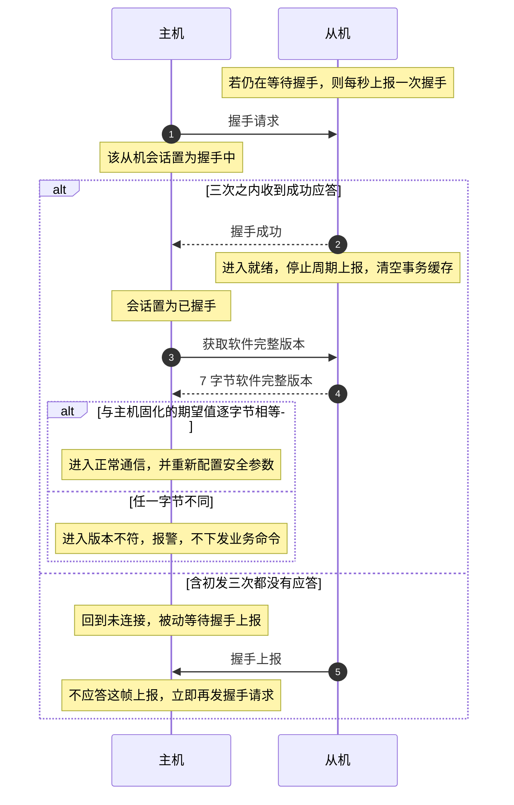

被动等待不得超过会话建立总时限。从上电到可以下发业务命令，推荐不超过 5 秒，含握手重试和版本核对，产品可以覆盖。超时仍未握手成功，按掉线处理并告警。

被动等待只覆盖“从机还在等待握手”。从机已经就绪但不回包时，仍靠主动探测，以及总时限之内的再次探测。整个重建过程都可以收下握手上报；对上报本身不应答，只在未连接或确认要重建会话时，用握手请求接纳。

版本比较按 7 个字节相等判断。载荷没有结尾的 `0x00`，不能把它当成以空字符结尾的字符串。协议版本不单占帧字段，随这次软件完整版本核对一起确认。

## 11 非幂等动作与事务缓存

获取类、设置类和本身幂等的动作类不带事务序号，协议层不去重。非幂等动作的请求载荷第一个字节是事务序号，取值 0 至 255，溢出后回绕。主机为每台从机单独计数。新的一次动作分配新序号；同一次动作因超时或校验失败而重传时，必须沿用原序号。

从机用一张先进先出缓存保存这些应答，索引是（命令码，事务序号）。规范没有规定这张表的条数。

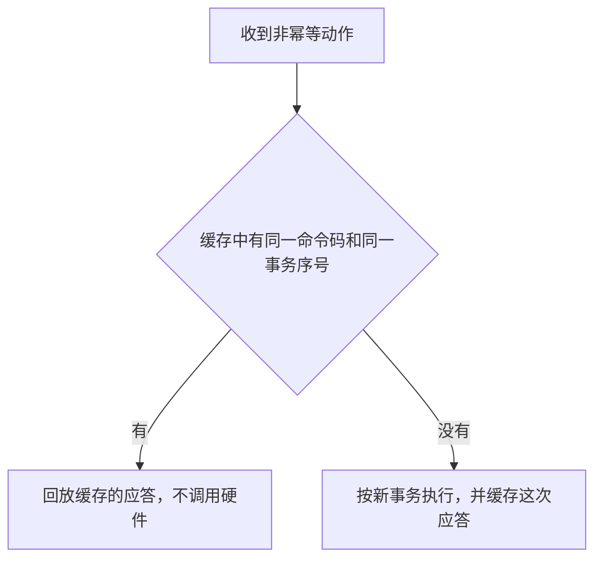

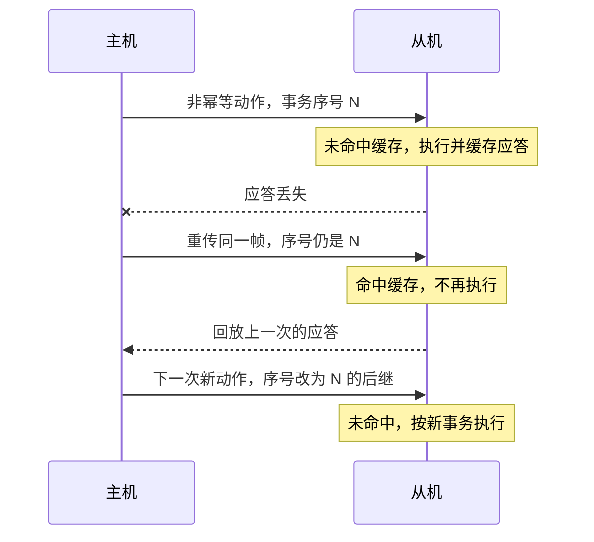

缓存在两处清空：从机软复位，以及每次收到握手请求。后一条保证主机重新从上电计数时，不会撞上上一次运行留下的旧条目。链路恢复必然先握手，握手已经清空缓存，所以恢复之后不会自动把丢失的业务请求再执行一遍。

系统复位的成功应答入队时，还不算软复位：会话仍是就绪，缓存仍在。同一序号的重传回放这条成功应答。真正复位发生后，才回到等待握手并清空缓存。若在应答入队时就清掉会话或缓存，同一次重传会得到未握手拒绝，或者把复位再执行一遍。这个窗口见 [ADR-0008](../adr/0008-txn-replay-across-the-reset-window.md)。

## 12 长耗时命令

长耗时命令先应答、后执行，再用一条事件帧通知结果。通用命令里有两对：

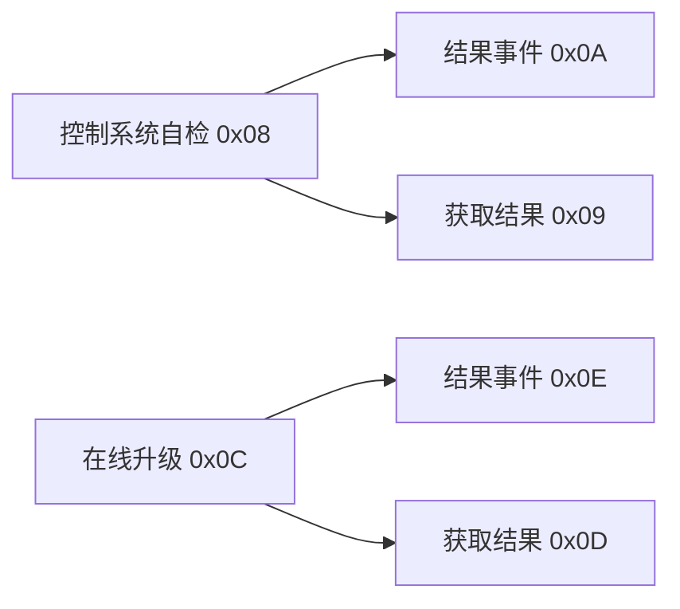

自检的最长执行时间推荐不超过 2000 ms，在线升级推荐不超过 60000 ms，都由产品覆盖。该字段是 2 字节无符号整数，单位毫秒，小端，最大 65535。预计会超过这个上限的命令，必须改用“结果事件加获取结果”，不得指望一个最长执行时间覆盖全程。

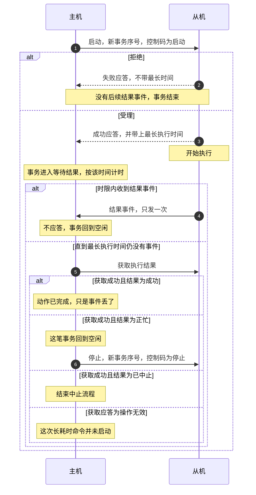

结果事件无应答、无重传。上传模式关掉因而事件不会到来时，主机仍要等到最长执行时间才发获取结果，不提前轮询。执行期间，获取类命令照常处理，心跳照常上报。

停止时若当前没有在途的自检或升级，应答 `0x13`。

在线升级还有一段失聪窗口：原子擦写期间从机可能收不到帧，停止只在数据块之间生效。主机在这个窗口里不重发停止，也不发获取，以免重传堆积；等到结果事件，或等到最长执行时间，再获取。中止之后，从机必须处在可以明确恢复的状态：旧固件仍能运行，或者明确进入映像无效、需要重新升级。签名、分包和回滚由产品规范定义。第一次受理应答本身仍须在 500 ms 内开始发出。

## 13 长耗时执行期间到达的其它命令

安全抢占、正交和互斥只针对这时到达的动作类和设置类。获取类不参与这三选一。

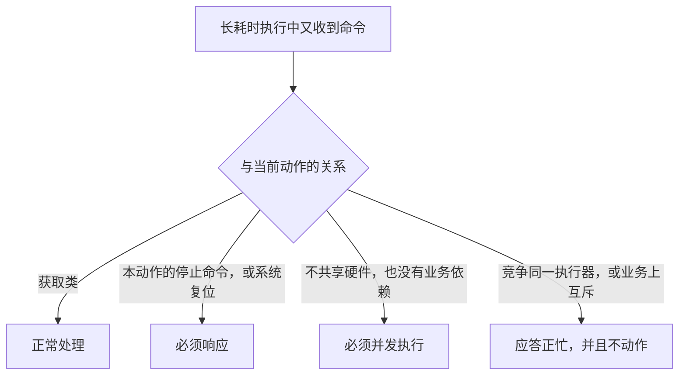

两条设置命令另有硬性结果，不靠实现自行归类：执行中请求进入低功耗，应答正忙；执行中设置上传模式，应答正忙，模式不变。

停止命令属于安全抢占，使用新的事务序号。系统复位的抢占步骤见第 14 节。

## 14 复位：预期、意外与抢占

下面的判定只用于双方已经完成握手之后。上电过程中的早到帧，以及未连接、握手中阶段收到的握手上报，都不是意外复位。

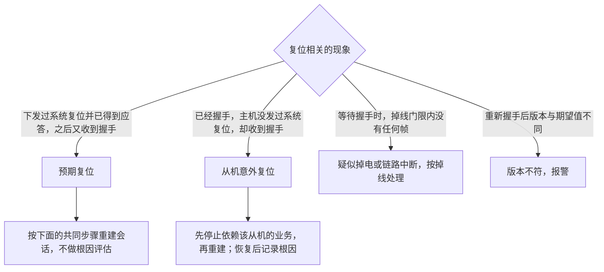

共同的恢复步骤：

```mermaid
sequenceDiagram
    autonumber
    participant H as 主机
    participant S as 从机
    S->>H: 握手上报或握手请求
    Note over H: 会话进入握手中。若还在等长耗时结果，取消该事务并记录中断
    H->>S: 握手请求
    S-->>H: 握手成功
    H->>S: 获取软件完整版本
    alt 与固化期望逐字节相等
        Note over H: 必要时再抽查硬件版本和序列号
        Note over H: 重新配置安全参数，然后恢复业务
    else 不相等
        Note over H: 版本不符，报警，不下发业务命令
    end
```

不在长耗时执行中时，系统复位先应答，再复位：

```mermaid
sequenceDiagram
    participant H as 主机
    participant S as 从机
    H->>S: 系统复位，事务序号 N
    S-->>H: 成功应答
    Note over S: 此时仍是就绪，事务缓存仍在
    Note over S: 同一 N 的重传回放这条成功应答
    Note over S: 序列还没走完时，新序号的又一次复位应答正忙
    Note over S: 真正复位之后才进入等待握手，并清空缓存
    S->>H: 握手上报
    Note over H: 这是预期复位
```

长耗时执行中的系统复位不能被忙拒绝，也不能做成立刻断电。每条长耗时命令都要在板卡规范里写明安全中止序列；写不出来的命令不得实现成长耗时命令。

```mermaid
flowchart TD
    busy["执行中收到系统复位"] --> abort["立即执行该命令的安全中止序列"]
    abort --> able{"序列已定义，并且执行成功"}
    able -->|是| ok["应答成功，随后复位"]
    ok --> noevent["不发送这次长耗时命令的结果事件"]
    noevent --> requery["主机重新握手后必须重新查询，不得假设结局"]
    able -->|否| fail["应答操作失败，不复位，置故障位并故障上报"]
```

中止序列或随后的复位序列还在进行时，再来的第二条系统复位应答正忙，不开始另一次复位。

## 15 低功耗

低功耗只改变链路行为，不改变会话状态。芯片怎样进入硬件低功耗，由产品或板卡规范定义。未实现这条命令时必须应答 `0x04`，不得真的进入低功耗。

```mermaid
flowchart TD
    enter["主机请求进入低功耗"] --> running{"长耗时命令执行中"}
    running -->|是| busy["应答正忙，不进入"]
    running -->|否| acked{"50 毫秒时限内，三次里收到成功应答"}
    acked -->|否| judge["不暂停掉线判定"]
    acked -->|是| quiet["从机停止一切主动上报；主机暂停该从机的掉线判定"]
    quiet --> later{"确认之后发生的事"}
    later -->|主机再次请求进入| stay["应答成功，继续保持安静"]
    later -->|主机请求退出并得到成功应答| resume["恢复心跳和掉线判定"]
    later -->|从机受理握手请求| wake["离开低功耗，心跳和掉线判定随即恢复"]
    later -->|主机请求系统复位| reset["真正复位后重新握手，心跳在会话重建后恢复"]
    later -->|主机要发其它业务命令| local["主机本地拒绝，链路上不出现对应帧"]
```

成功应答入队之后，心跳不再发送；已经排队但还没发出的故障上报和结果事件也先压住。从机仍然应答收到的请求。会话保持正常通信。

已经确认低功耗之后再次进入，从机应答成功并继续保持安静。主机本地拒绝业务命令的原因，要和“会话不是正常通信”分开记录。

低功耗期间收到握手请求：从机离开低功耗，随后按第 9 节和第 10 节的握手规则继续。收到进入、退出、复位、握手以外的帧：照常应答，并保持低功耗。

## 16 上传模式

上传模式决定从机发不发结果事件和故障主动上报。它不写入非易失存储。上电值来自从机配置；产品没有另外声明时，初值是开启。配置值既不是开启也不是关闭，则初始化失败，不能把没填写当成关闭。重新初始化后回到配置初值。

```mermaid
stateDiagram-v2
    state "开启" as on
    state "关闭" as off

    [*] --> on: 配置初值为开启
    [*] --> off: 配置初值为关闭
    on --> off: 控制码为关闭
    off --> on: 控制码为开启
    on --> on: 再次写入开启
    off --> off: 再次写入关闭
```

两个合法控制码都应答成功。其它控制码应答参数无效，模式不变。会话还没建立时应答未握手拒绝，模式不变。长耗时执行期间应答正忙，模式不变。应答时限是 50 ms。这条命令没有事务序号。

关闭期间不发送自检结果、升级结果和故障主动上报。心跳仍按周期发送，等待握手期间的握手上报仍发送。结果仍可用对应的获取命令读到，故障仍可用获取故障状态读到。

关闭期间才就绪的那三帧，再次开启时不补发。再次接受握手请求时，模式回到配置里的上电初值；即使因此变回开启，错过的帧仍不补发。已经进入发送 FIFO 的字节不撤回。只因为发送 FIFO 满而还没发出的帧，之后照常发出，包括握手之后。

主机不保存从机当前的上传模式。

和低功耗的差别：

| 主动帧 | 上传模式关闭 | 已确认低功耗 |
| --- | --- | --- |
| 心跳 | 仍按周期发送 | 不发送 |
| 等待握手时的握手上报 | 仍按 1 Hz 发送 | 低功耗时会话已建立，不处在等待握手 |
| 自检结果、升级结果、故障上报 | 不发送，之后也不补发 | 先压住；退出后允许发出。若此时上传仍关闭，则不发 |
| 对请求帧的应答 | 照常应答 | 照常应答 |

用退出低功耗恢复时，若上传模式仍是关闭，被压住的那三帧也不补发；心跳仍按低功耗规则恢复。低功耗期间心跳始终不发，打开上传模式不能代替退出低功耗。

## 17 心跳与掉线

心跳周期 1000 ms，允许偏差 ±10%。产品若覆盖周期，必须同步修改掉线门限。主机不以心跳为唯一依据：该从机的任一有效主动上报或应答，都刷新最后活跃时间。

从机在会话建立后，每秒检查一次。距上次成功发出主动上报或应答已满 1 秒，就补一帧心跳。等待握手期间发的是握手上报，不是心跳。

```mermaid
flowchart TD
    tick["从机的 1 秒检查"] --> power{"当前处于低功耗"}
    power -->|是| silent["不发送心跳"]
    power -->|否| due{"距上次成功发出主动上报或应答已满 1 秒"}
    due -->|是| beat["发送心跳"]
    due -->|否| skip["本拍不补"]
```

主机同样每秒检查一次。当前时间减去最后活跃时间大于 3 秒，会话置为掉线。双方随后进入安全状态或降级模式；恢复通信后必须重新握手。

```mermaid
flowchart TD
    check["主机的 1 秒检查"] --> low{"该从机已确认低功耗"}
    low -->|是| ignore["沉默不判掉线"]
    low -->|否| storing{"正在等待硬件版本或序列号的三次应答之一"}
    storing -->|是| hold["不按 3 秒提前掉线"]
    storing -->|否| gap{"沉默已超过 3 秒"}
    gap -->|是| down["会话置为掉线"]
    gap -->|否| up["保持当前会话"]
```

`0x03`、`0x05` 三次都没有应答之后，才因这笔事务超时进入掉线。等待握手状态下，掉线门限内没有任何帧，按掉线处理，不判成意外复位。

## 18 故障上报

故障字的 bit0 固定为系统自检失败：自检判定失败时置位，其后一次自检成功时清除，不得改作其它含义。bit1 至 bit7 由板卡规范定义含义和置位、清除条件，同一产品内各板卡不得冲突。

```mermaid
flowchart LR
    b0["bit0 固定：系统自检失败"] --- ext["bit1 至 bit7：板卡规范定义"]
```

上报看上升沿，不看电平。

```mermaid
flowchart TD
    sample["检测到当前故障字"] --> edge{"是否有位从 0 变为 1"}
    edge -->|没有| none["不发送故障上报；仅清除时也不发送"]
    edge -->|有| once["只发送一帧，载荷是变化后的整个故障字"]
    once --> stop["主机按置位停止对应业务"]
    stop --> back{"该位已清除，且获取到的故障字不再含该位"}
    back -->|是| resume["才允许恢复对应业务"]
    back -->|否| hold["继续停止"]
```

同一次检测里多位同时从 0 变为 1，仍然只发一帧。已经为 1 的位，在清除之前不得因为该位再报一次。上报载荷恒不为 0；全 0 只允许出现在获取故障状态的应答里。

主机收到非 0 的故障字后按置位停止对应业务。板卡规范未分配却为 1 的位按未知故障处理：停止依赖本节点的业务，并记录。故障上报丢失时，用获取故障状态确认。这条上报受上传模式和低功耗约束，见第 16 节的对照表。

## 19 主机看到应答码之后

从机按应答码的语义返回，主机按下表的同一套动作处理。保留码和板卡扩展码没有通用动作。

```mermaid
flowchart TD
    code{"应答码"}
    code -->|成功| ok["事务完成；若是长耗时受理，则记下最长时间并等待结果"]
    code -->|未指定错误、长度错误、参数无效或不支持| log["记录日志，报告缺陷，不重试"]
    code -->|未握手拒绝| hello["先完成握手，再重发"]
    code -->|操作正忙| wait["等待结果事件，或到时后获取结果；若忙的是复位，则等复位后重新握手"]
    code -->|模式异常| mode["先切换模式，再重试"]
    code -->|操作无效| cond["满足前置条件后重试"]
    code -->|模块锁定| unlock["先解锁，再重试"]
    code -->|系统锁定| safety["停止自动重试，上报用户并走安全流程"]
    code -->|操作失败| policy["按产品安全策略处理，并经由故障上报或获取故障状态观察"]
    code -->|已中止| aborted["结束中止流程"]
    code -->|板卡扩展| board["按该板卡规范处理，同一产品内取值不得冲突"]
```

长耗时命令的成功有两层含义：普通命令表示执行完成；长耗时命令的第一次成功只表示已经受理并开始执行。拒绝时不带最长执行时间，也没有结果事件。
