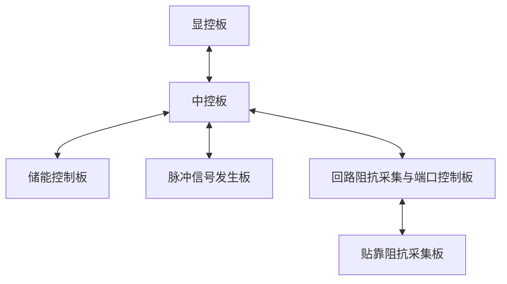

# 1 引言

## 1.1 目的

本文件定义脉冲信号发生板（Pulse signal generator, PSG）与中控板之间的完整串口通信协议（含帧格式、通用命令、本板功能命令及本板业务约束），作为双方软件设计、编码、单元测试与系统联调的共同依据，并为产品 SRS 中的接口需求提供实现层细节。预期读者包括：嵌入式软件工程师、上位机软件工程师、测试工程师。

## 1.2 适用范围

本文档适用于心脏脉冲电场消融设备下的脉冲信号发生板与中控板之间的串行通信链路，采用其他协议或接口形式的通信（如 USB、网络等）不在本文档范围内。

## 1.3 术语和定义

* **UART**：Universal Asynchronous Receiver/Transmitter，即通用异步收发器，串行通信接口。
* **CRC**：Cyclic Redundancy Check，即循环冗余校验。
* **LSB**：Least Significant Byte，即最低有效字节。
* **MSB**：Most Significant Byte，即最高有效字节。
* **Host**：主机，即主控方。
* **Slave**：从机，即应答方。
* **ECSP**：Equipment Custom Serial Protocol，即设备组自定义串行通用协议。
* **本板**：脉冲发生板。

## 1.4 参考文档

**表 1-1 规范性引用文档**

| 文档名称 | 版本 |
| --- | --- |
| 医疗器械软件注册审查指导原则 | 2022年修订版 |

## 1.5 文档约定

本文数值除注明外均采用十六进制表示（前缀 0x）。

# 2 通信总体描述

## 2.1 通信架构与角色

ECSP 的通信架构为一主多从拓扑：

* 主机（Host）：为通信发起方与链路管理者
* 从机（Slave）：为应答方。从机仅在握手、心跳与事件上报场景下允许主动发送，从机之间不直接通信。

主机对每台从机的寻址由产品地址与板卡地址两个字段完成，即寻址唯一键为 **(产品地址, 板卡地址)**。设备中各板卡通信拓扑见图 2-1，各链路的通信角色见表 2-1。

**图 2-1 设备各板卡通信拓扑图**

**表 2-1 各板卡通信角色**

| 通信链路 | 主机（Host） | 从机（Slave） |
| --- | --- | --- |
| 显控板 — 中控板 | 显控板 | 中控板 |
| 中控板 — 储能控制板 | 中控板 | 储能控制板 |
| 中控板 — 脉冲信号发生板 | 中控板 | 脉冲信号发生板（本板） |
| 中控板 — 回路阻抗采集与端口控制板 | 中控板 | 回路阻抗与端口控制采集板 |
| 回路阻抗采集板 — 贴靠阻抗采集板 | 回路阻抗与端口控制采集板 | 贴靠阻抗采集板 |

心脏脉冲电场消融设备的产品地址为 0x03，各板卡地址见表 2-2。

**表 2-2 各板卡地址**

| 板卡名称 | 板卡地址 |
| --- | --- |
| 中控板 | 0x01 |
| 脉冲信号发生板 | 0x02 |
| 回路阻抗采集与端口控制板 | 0x03 |
| 储能控制板 | 0x04 |
| 贴靠阻抗采集板 | 0x05 |

## 2.2 物理层参数

本板物理层参数如下：

* 接口类型：UART（TTL 3.3V）
* 波特率：115200 bps
* 数据位：8
* 停止位：1
* 校验位：无
* 流控制：无

调整波特率时通信双方须同步更新并重新验证第 7 章时序要求。

## 2.3 通信机制概述

协议的基础交互模型为请求-应答：主机发送请求帧后，从机必须在规定响应时间内返回应答帧；应答超时后主机按 6.2 节规则重发，同一命令含初发最多发送 3 次。主机对事件帧不应答，对握手上报的处理见 4.1 节。

在请求-应答基础上，协议定义以下通信机制，详见第 4 章：上电与握手流程（4.1 节）、动作类命令的幂等控制（4.2 节）、长耗时命令处理机制（4.3 节）、复位检测与恢复（4.4 节）。

# 3 帧格式定义

## 3.1 基本帧结构

**表 3-1 基本帧结构**

| 字段 | 长度（字节） | 说明 | 编码规则 |
| --- | --- | --- | --- |
| 帧头 | 1 | 固定为 0xFA，用于帧头识别 | / |
| 帧长度 | 2 | 表示从帧头到帧尾整个帧的字节数；本板实现最大帧长为 512 字节 | 小端字节序 |
| 产品地址 | 1 | 同一产品含多个板卡时，产品地址相同 | / |
| 命令码 | 1 | 标识命令语义，分配规则见 3.5 节 | / |
| 板卡地址 | 1 | 用于在同一产品总线上唯一标识一个板卡 | / |
| 数据载荷 | N | 可为空。 | 见 3.3 节 |
| 帧校验 | 2 | 用于进行错误校验，见 3.2 节 | 小端字节序 |
| 帧尾 | 1 | 固定为 0x0D，用于帧尾识别 | / |

## 3.2 错误校验机制

帧结构中包含一个错误校验字段，该字段基于循环冗余校验（CRC）生成，覆盖范围为帧长度字段的第一个字节至数据载荷字段的最后一个字节，CRC 算法采用 **CRC16-MODBUS**。

## 3.3 数据载荷编码规则

本协议中所有多字节整数、浮点数及帧级多字节字段（如帧长度、帧校验）均默认采用小端字节序，除非某字段另有说明。数据载荷字段编码规则如下：

* **无符号整数**：二进制原码，小端字节序。例如十进制数513（0x0201）在数据载荷中编码为十六进制连续字节为（01 02）。
* **有符号整数**：二进制补码，小端字节序。
* **浮点数**：IEEE 754 单精度，小端字节序。
* **字符串**：默认定长字符串，ASCII 编码，帧内不含 0x00；变长字符串仅在该命令明确声明时以 0x00 结尾。

## 3.4 帧类型与命令类别

帧类型定义的是“通讯交互模型与时序机制”，它决定怎么传、谁发起、是否需要应答；而命令类型定义的是“业务逻辑与行为语义”，它决定做什么、改什么、是否幂等。

### 3.4.1 帧类型

#### 3.4.1.1 请求帧（Host → Slave）

通常由主机发起的单向索取或控制的帧，其核心特征是强绑定超时与重传机制，发起方发出后必须等待接收方的应答回复。

#### 3.4.1.2 应答帧（Slave → Host）

接收方对请求帧的应答回复。其核心特征是被动触发且必须携带应答码，若请求帧需要数据则还需要数据。应答帧的命令字段必须与请求帧的命令字段相同以此实现一对一匹配闭环。示例如下：

* 请求帧：`[FA] [09 00] [03] [01] [02] [CRC16] [0D]`
* 应答帧：`[FA] [0A 00] [03] [01] [02] [00] [CRC16] [0D]`

#### 3.4.1.3 主动上报帧（Slave → Host）

从机节点在无外部获取请求的情况下，由内部条件自主触发向外定向发送的帧。其核心特征是异步性，打破了严格的“主发从随”轮询死锁，使从机具备向主机主动通知的能力。

#### 3.4.1.4 特殊会话帧（Host ↔ Slave）

用于建立或恢复会话的握手交互（命令码 0x01），主机和从机均可进行发送，完整流程见 4.1 节。

### 3.4.2 命令类别

#### 3.4.2.1 获取类（Get）

只读操作。语义是获取设备当前状态、传感器测量值或配置值等。该类命令具备幂等性与零副作用，多次连续获取不会改变设备的运行状态。

#### 3.4.2.2 设置类（Set）

写入操作。语义是将一组预定义参数、阈值或配置写入设备。在设计时，必须设计为幂等写，防止重复写入与最终预期结果不一致。

#### 3.4.2.3 动作类（Action）

行为触发操作。语义是用于触发设备执行特定行为或状态机迁移（如电机启停、开关切换、零点校准、软件复位等）。动作类命令又具体分为：

* 幂等动作类命令：重复执行不会产生累积副作用或状态偏差（即“多次执行等同于一次执行”），例如强制置位、特定状态对齐；
* 非幂等动作类命令：重复执行可能导致设备状态错乱、物理器件受损或业务逻辑异常（例如：重复复位、多输出一次脉冲）。针对此类命令，必须引入事务序号机制来进行严格防护，见 4.2 节。

#### 3.4.2.4 事件类（Event）

状态变更或客观事实通知。语义是通告设备的状态或内部发生的重要边界事件（如硬件故障、阈值越限、探头脱落、生命体征异常），其侧重点是信息通知。事件类命令又具体分为：

* 周期上报事件类命令（如 0x10 心跳）；
* 单次上报事件类命令（如 0x0A 系统自检结果上报）。

#### 3.4.2.5 特殊会话类（Session）

仅用于握手请求/握手上报（0x01）。主机与从机均可发送，承载于特殊会话帧；主机对从机主动握手上报不应答，从机对主机握手请求须应答。完整流程见 4.1 节。

**表 3-3 命令类别与帧类型映射矩阵**

| 命令分类 | 承载的帧类型 | 通信流向 | 其它说明 |
| --- | --- | --- | --- |
| 获取类 | 请求帧 + 应答帧 | 主机 → 从机 | - |
| 设置类 | 请求帧 + 应答帧 | 主机 → 从机 | 必须保证幂等写 |
| 动作类 | 请求帧 + 应答帧 | 主机 → 从机 | 若为非幂等命令须增加事务序号防护，见 4.2 节 |
| 事件类 | 主动上报帧 | 从机 → 主机 | - |
| 特殊会话类 | 特殊会话帧（及握手请求的应答帧） | 主机 ↔ 从机 | - |

## 3.5 命令码分配规则

命令码分配规则如下：

* 0x00 保留
* 0x01~0x2F 为通用命令
* 0x30~0xEF 为板卡功能命令

通用命令详见 5.2 节，本板功能命令详见 5.3 节。

## 3.6 应答码定义

应答码（Response Code）是应答帧数据载荷首字节的标量字段，用于向发起方指示该请求是否被成功受理或执行，若失败则指示卡在哪一环节。

**表 3-4 应答码定义表**

| 应答码 | 名称 | 含义 |
| --- | --- | --- |
| 0x00 | 操作成功 | （1）命令执行成功；（2）长耗时命令已受理并开始执行 |
| 0x01 | 未指定错误 | 无法归类的失败兜底 |
| 0x02 | 数据载荷长度错误 | 载荷长度与命令定义不符 |
| 0x03 | 数据载荷参数无效 | 长度正确但数据载荷内容非法：越界/格式/取值错 |
| 0x04 | 不支持的命令操作 | 命令码未定义或本板不支持该命令 |
| 0x05~0x0F | 保留 | — |
| 0x10 | 未握手拒绝 | 等待握手状态下收到非握手（0x01）命令 |
| 0x11 | 操作正忙 | 长耗时命令执行中收到新的长耗时/动作命令 |
| 0x12 | 模式异常 | 当前工作模式不允许该操作 |
| 0x13 | 操作无效 | 前置条件/上下文不满足（区别于参数无效）。例如尚未启动长耗时命令时就查询执行结果 |
| 0x14 | 模块锁定 | 涉及模块被锁定 |
| 0x15 | 系统锁定 | 整机锁定/安全锁存 |
| 0x16~0x1F | 保留 | — |
| 0x20 | 操作失败 | 执行阶段非预期失败（含硬件类故障） |
| 0x21 | 已中止 | 长耗时命令被 Host 以控制码 0x01 主动中止 |
| 0x22~0x2F | 产品扩展 | 由产品规范定义；本板不使用 |

# 4 通信机制

本章定义协议运行所需的动态行为规则：上电与握手流程、动作类命令的事务序号幂等控制、长耗时命令处理、复位检测与恢复。

## 4.1 上电与握手流程

本节定义主机与从机上电/复位后的会话建立规则，命令码均为握手请求/握手会话（0x01）：主机下发的为握手请求帧（须应答）；从机周期上报的为握手会话帧（主机不应答）。超时与重发规则见 6.2 节。

主机对每台从机维护独立观测状态，至少包含：

| 观测状态 | 含义 |
| --- | --- |
| 未连接 | 尚无有效会话；可主动发握手请求，也可因收到握手会话帧而发握手请求 |
| 握手中 | 已发出握手请求，等待应答或按 6.2 节超时重发 |
| 已握手 | 已收到握手应答 0x00；尚未完成软件完整版本相等核对 |
| 正常通信 | 已通过软件完整版本相等核对，允许下发业务命令 |

多从机时，各板卡地址的状态机、重发计数与会话建立计时相互独立。

### 4.1.1 主机上电操作

主机自身上电或复位后，不得假设从机状态确定，必须按下列顺序重建会话。

（1）主动握手探测
若从机在主机复位前已完成握手并处于就绪，从机不会再周期发送握手会话帧，主机仅靠等待上报无法重建会话，因此主机必须主动下发握手请求帧（0x01）。
握手请求按 6.2 节做应答超时重发，同一轮探测含初发最多发送 3 次。发出请求后主机将该从机观测状态置为“握手中”。

（2）主动探测失败后的被动等待
若含初发共 3 次仍未收到握手应答：

* 将该从机保持或迁回“未连接”；
* 进入被动等待：等待该从机主动上报的握手会话帧（0x01）；
* 被动等待期间，一旦收到该从机握手会话帧，主机必须立即再次进入步骤 2 下发握手请求帧进行接纳；
* 被动等待不得超过表 7-2「会话建立总时限」（上电至可下发业务命令推荐 ≤5 s，产品可覆盖）。超时仍未握手成功时，主机按 6.2 节断链处理并告警。

说明：被动等待用于覆盖“从机仍在等待握手、尚未或未能及时应答主动请求”的情形；对“从机已就绪但不回包”的情形，仍依赖步骤 2 的主动探测及会话总时限内的再次探测（收到上报后重入步骤 2，或产品在总时限内按更长周期再次发起步骤 2）。

（3）握手成功后的版本核对与安全配置
主机收到从机对握手请求的应答 0x00 后，判定握手成功，将该从机观测状态置为“已握手”。此后主机必须：

* 下发获取软件完整版本（0x02）命令，将应答中的软件完整版本号（7 字节定长字符串）与主机固件内固化的期望版本做逐字节相等比较（见 9.2 节）；
* 完全相等后，方可将该从机置为“正常通信”并下发业务命令；不相等时，主机不得进入正常通信并报警；
* 进入正常通信后，主机必须重新配置安全相关参数（不得沿用复位前的会话假设）。

在整个上电/复位重建过程中，主机均可接收从机主动发送的握手会话帧（0x01）；对握手会话帧不应答，仅在“未连接”或按 4.1.4 节判定需重建时，用握手请求帧完成接纳。

### 4.1.2 从机上电操作

从机上电完成初始化、自检并具备通信能力后，进入“等待握手”状态，以 1 Hz 频率主动发送握手会话帧（0x01），直至握手成功。

在“等待握手”状态下：

* 从机仅处理主机下发的握手请求帧（0x01）；
* 对其它请求帧一律应答 0x10（未握手拒绝），不执行对应业务。

### 4.1.3 握手与会话建立

正常会话建立顺序如下（主动探测与被动上报两条路径均收敛到同一次“请求—应答”）：

* 从机：处于“等待握手”时，以 1 Hz 周期上报握手会话帧（0x01）；
* 主机：在“未连接”下，或因收到握手会话帧而决定接纳时，下发握手请求帧（0x01）；主机对握手会话帧本身不应答；
* 从机：收到握手请求帧后应答 0x00，停止周期上报握手会话帧，进入“就绪”状态；
* 主机：收到应答 0x00 后判定握手成功（观测状态“已握手”），再按 4.1.1 节步骤 4 完成版本核对与安全参数配置后进入“正常通信”。

主机也可在尚未收到握手会话帧时先执行 4.1.1 节步骤 2 的主动探测；从机在“等待握手”下对握手请求的处理与上列步骤 3 相同。

### 4.1.4 握手异常场景处理

下列规则仅适用于双方已经完成握手之后（从机已就绪，主机侧该从机至少为“已握手”或“正常通信”）。上电置态完成前的早到帧、以及“未连接/握手中”阶段收到的握手会话帧，不适用本小节的“意外复位”判定。

* 主机意外复位（从机侧判定）
  若从机在已就绪后再次收到主机下发的握手请求帧（0x01），则判定主机为意外复位：立刻停止正在执行的所有业务，应答 0x00，进入“就绪”状态（若此前因握手请求而停止周期上报，保持就绪、不再恢复等待握手周期上报）。主机侧按 4.1.1 节继续完成版本核对与安全参数重配。
* 从机意外复位（主机侧判定）
  若主机在该从机已握手或正常通信后，再次收到其上报的握手会话帧（0x01），则判定从机为意外复位：立刻停止依赖该从机的业务，将该从机观测状态置为“未连接”，并回送握手请求帧，重新执行 4.1.1 节操作（含版本核对与安全参数重配）。意外复位与预期复位的后续恢复差异见 4.4 节。

## 4.2 动作类命令的幂等控制

动作类命令用于触发物理过程或驱动状态机跃迁。其中：

* 非幂等动作（如能量触发、状态翻转等）重复执行会导致物理危害或逻辑错乱；
* 天然幂等动作（如停机、故障清除、绝对位置归零等）重复执行无物理累加危害。

由于串行链路存在“从机已执行但应答丢失”的可能，主机超时重传极易引发非预期二次执行。为保证可靠性，非幂等动作类命令在帧载荷首字节强制携带 1 字节事务序号，由从机实现去重与重传结果回放。具体规则如下：

* 字段定义与编号空间
  非幂等动作类命令的请求帧载荷首字节为 1 字节事务序号。主机为每台从机维护独立的单调递增计数器，取值范围为 0~255，溢出后自动回绕。
* 事务绑定与重传复用
  主机在每次新发起非幂等动作命令时必须分配新的事务序号；当发生通信超时、校验失败触发的同一次事务重传时，必须复用初始事务序号，严禁重传递增事务序号。
* 结果缓存与去重回放
  从机维护一张先进先出（FIFO）的动作结果缓存表，以 (命令码, 事务序号) 为唯一索引，缓存最近执行完毕的应答帧（含应答码及关联状态）。
  * 从机收到非幂等动作请求时，优先检索缓存表；
  * 若命中缓存，从机严禁重复调用底层硬件驱动，直接将缓存的应答帧重新回传给主机；
  * 若未命中缓存，从机按新事务进入底层执行流程。
  * 缓存生命周期：从机发生软复位后，清空该缓存。
* 豁免范围
  获取类命令、设置类命令以及幂等性动作类命令不携带事务序号字段，协议层不进行去重拦截。幂等性动作类命令仍须按请求-应答返回确定的执行状态。

## 4.3 长耗时命令处理机制

长耗时命令采用“先应答、后执行、事件通知结果”机制：

* 从机先应答后执行：第一次应答 0x00 并携带最长执行时间（T_exec_max）。该字段为 2 字节无符号整数（u16），单位为毫秒（ms），小端字节序。表示已受理并开始执行，从机进入 BUSY，主机据此启动定时器；若拒绝则回相应应答码且不携带该字段、无后续结果事件。
* 从机结果事件通知：从机执行结束（含成功、失败、中止）后以独立事件命令单次上报结果，事件无应答、无重传。
* “获取执行结果”命令兜底：每个长耗时命令必须配有相应的“获取执行结果”命令，用于主机在等待结果时发生超时或结果事件丢失时的兜底。“获取执行结果”命令的应答帧中，应答码表示本次获取是否成功，结果码表示长耗时命令的执行状态。
* 从机执行超时：主机必须先发送获取结果命令，若应答码为 0x00 且结果码为 0x00，表示从机实际已完成、仅结果事件丢包，可正常闭环；若应答码为 0x00 且结果码为 0x11（操作正忙），表示从机仍在执行但已超过最长执行时间（T_exec_max），主机必须下发对应停止控制（控制码 0x01）主动终止。
* BUSY 期间保活：从机对于主机下发的获取类命令可正常接收，从机的心跳命令保持上传。

### 4.3.1 长耗时动作执行期间到达的其他动作类/设置类命令

在从机进行长耗时动作执行期间，若有其它动作类/设置类命令到达，分为三类不同的处理策略：

* 安全抢占类：此类动作的意图本身就是为了影响/终止当前正在运行的动作，从机必须无条件响应。例如对应的停止命令；
* 硬件资源/业务正交类：若新动作所支配的硬件资源/业务与当前动作没有任何共享依赖，则从机应完全支持并发执行。例如电容正在执行长耗时的高压恒流充电（占用内部定时器和ADC），此时主机下发“打开散热风扇”命令（占用继电器GPIO），从机必须接收并执行。
* 硬件资源冲突/业务互斥类动作：当新动作需要竞争同一个物理执行器或者业务模式是互斥时，从机必须拒绝命令并不做任何动作，回复忙应答码。例如高压脉冲正在放电，此时主机下发“设置脉冲参数”命令，从机必须拒绝执行并回复忙应答码。

## 4.4 复位检测与恢复

从机复位来源包括：主机下发的系统复位（0x07）命令、硬件复位（看门狗、掉电重启、欠压复位）与软件异常复位。主机必须能够判定复位性质并按流程恢复会话，判定规则见表 4-2。

**表 4-2 复位性质判定**

| 场景 | 判定 | 处理 |
| --- | --- | --- |
| 主机下发系统复位（0x07）命令并收到应答后，一段时间过后收到该从机的握手（0x01）命令 | 预期复位 | 按 4.1.3 节重新握手 |
| 从机已经完成握手、主机未下发系统复位（0x07）命令，却收到该从机握手请求/握手上报（0x01）命令 | 从机意外复位 | 停止依赖业务，按恢复流程重建会话，并评估误复位根因 |
| 等待握手状态断链门限内无任何帧 | 疑似掉电或断链 | 按 6.2 节断链处理 |
| 复位后获取软件完整版本（0x02）命令返回的软件完整版本与主机固化期望版本不相等 | 固件被更换或升级生效 | 按 9.2 节相等核对；不相等则拒绝正常通信并报警 |

意外复位与预期复位的恢复流程相同：

* 主机收到握手请求/握手上报（0x01）命令后，将该从机观测状态迁回 HANDSHAKING；若 BUSY，取消在途事务并记录执行中断；
* 回送握手命令完成接纳（见 4.1.3 节）；
* 下发获取软件完整版本（0x02）命令，按 9.2 节与主机固化期望版本做相等核对，必要时抽查获取硬件版本（0x04）命令/获取序列号（0x06）命令确认配置未变；
* 重新配置安全相关参数后恢复业务；预期复位可跳过根因评估，意外复位必须在恢复后完成根因记录。

长耗时命令执行期间（BUSY）收到系统复位（0x07）命令：从机应答 0x11（操作正忙），主机应先按 4.3.1 节中止在途命令，再发起复位；该约束与表 3-4 应答码定义一致。

# 5 命令集定义

## 5.1 命令总表

### 5.1.1 通用命令

**表 5-1 通用命令总表**

| 命令码 | 命令名称 | 方向 | 命令类别 |
| --- | --- | --- | --- |
| 0x01 | 握手请求/握手上报 | Host↔Slave | 特殊会话类 |
| 0x02 | 获取软件完整版本 | Host→Slave | 获取类 |
| 0x03 | 设置硬件版本 | Host→Slave | 设置类 |
| 0x04 | 获取硬件版本 | Host→Slave | 获取类 |
| 0x05 | 设置序列号 | Host→Slave | 设置类 |
| 0x06 | 获取序列号 | Host→Slave | 获取类 |
| 0x07 | 系统复位 | Host→Slave | 动作类 |
| 0x08 | 控制系统自检 | Host→Slave | 动作类（长耗时） |
| 0x09 | 获取系统自检结果 | Host→Slave | 获取类 |
| 0x0A | 系统自检结果上报 | Slave→Host | 事件类（单次） |
| 0x0B | 设置低功耗模式 | Host→Slave | 设置类（本板不支持） |
| 0x0C | 在线升级 | Host→Slave | 动作类（长耗时） |
| 0x0D | 获取在线升级结果 | Host→Slave | 获取类 |
| 0x0E | 在线升级结果上报 | Slave→Host | 事件类（单次） |
| 0x0F | 控制上传模式 | Host→Slave | 设置类 |
| 0x10 | 心跳周期上报 | Slave→Host | 事件类（周期） |
| 0x11 | 故障主动上报 | Slave→Host | 事件类（单次） |
| 0x12 | 获取故障状态 | Host→Slave | 获取类 |
| 0x13~0x2E | 保留，用于后续扩展 | — | — |
| 0x2F | 通用应答命令 | Slave->Host | 事件类（单次） |

### 5.1.2 板卡功能命令

**表 5-2 板卡功能命令总表**

| 命令码 | 命令名称 | 方向 | 命令类别 |
| --- | --- | --- | --- |
| 0x30 | 启动/停止脉冲输出 | Host→Slave | 动作类（非幂等） |
| 0x31 | 获取脉冲输出状态 | Host→Slave | 获取类 |
| 0x32 | 设置同步触发使能 | Host→Slave | 设置类 |
| 0x33 | 获取同步触发使能 | Host→Slave | 获取类 |
| 0x34 | 设置脉冲序列参数 | Host→Slave | 设置类 |
| 0x35 | 获取脉冲序列参数 | Host→Slave | 获取类 |
| 0x36 | 设置同步触发参数 | Host→Slave | 设置类 |
| 0x37 | 获取同步触发参数 | Host→Slave | 获取类 |
| 0x38 | 设置电流检测阈值 | Host→Slave | 设置类 |
| 0x39 | 获取电流检测阈值 | Host→Slave | 获取类 |
| 0x3A | 设置脉冲输出电压 | Host→Slave | 设置类 |
| 0x3B | 获取脉冲输出电压 | Host→Slave | 获取类 |
| 0x3C | 脉冲输出状态上报 | Slave→Host | 事件类（单次） |
| 0x3D | 清除电流故障 | Host→Slave | 动作类（幂等） |
| 0x3E | 设置启停控制通路 | Host→Slave | 设置类 |
| 0x3F | 获取启停控制通路 | Host→Slave | 获取类 |
| 0x40 | 设置杆对循环使能 | Host→Slave | 设置类 |
| 0x41 | 获取杆对循环使能 | Host→Slave | 获取类 |

## 5.2 命令详细定义

### 5.2.1 握手请求/握手上报（0x01）

**（1）命令基本信息**

* 命令类别：特殊会话类
* 方向：Host↔Slave
* 功能说明：建立或恢复会话
* 安全关键：否
* 请求帧数据载荷：无
* 应答帧数据载荷：仅应答码

**（2）应答帧数据载荷字段**

* 应答码
  * 0x00：完成握手，从机进入就绪并停止周期握手上报
  * 0x01：未指定错误
  * 0x02：请求帧带了非空载荷

**（3）示例**

* 从机主动上报帧（周期）示例：[FA] [09 00] [03] [01] [02] [CRC16] [0D]
* 主机请求帧示例：[FA] [09 00] [03] [01] [02] [CRC16] [0D]
* 从机应答帧示例：[FA] [0A 00] [03] [01] [02] [00] [CRC16] [0D]

### 5.2.2 获取软件完整版本（0x02）

**（1）命令基本信息**

* 命令类别：获取类
* 方向：Host→Slave
* 功能说明：Host 获取 Slave 当前固件软件完整版本号，用于握手后与主机固化期望版本的相等核对（见第 9 章）
* 安全关键：否
* 请求帧数据载荷：无
* 应答帧数据载荷：应答码（1字节）+软件完整版本号（7字节）

**（2）应答帧数据载荷字段**

* 应答码
  * 0x00：获取成功，其后为软件完整版本号
  * 0x01：未指定错误
  * 0x02：请求帧带了非空载荷
  * 0x10：未握手拒绝
* 软件完整版本号（7字节）
  * 软件完整版本号定义见《医疗器械软件注册审查指导原则（2022年修订版）》参考文档，其为定长字符串，格式为 "X.Y.Z.N"。

**（3）示例**

假设从机的软件完整版本号为“1.0.0.0”，则

* 主机请求帧示例：[FA] [09 00] [03] [02] [02] [CRC16] [0D]
* 从机应答帧示例：[FA] [11 00] [03] [02] [02] [00] [31 2E 30 2E 30 2E 30] [CRC16] [0D]

### 5.2.3 设置硬件版本（0x03）

**（1）命令基本信息**

* 命令类别：设置类
* 方向：Host→Slave
* 功能说明：Host 向 Slave 写入硬件版本号，成功后 Slave 应持久化保存。通常仅用于生产或维护场景。
* 安全关键：是（影响唯一标识与追溯），见第 8 章
* 请求帧数据载荷：硬件版本号
* 应答帧数据载荷：仅应答码

**（2）请求帧数据载荷字段**

* 硬件版本号（7字节）
  * 格式和编码规则与软件完整版本号相同。

**（3）应答帧数据载荷字段**

* 应答码
  * 0x00：写入成功并已持久化
  * 0x01：未指定错误
  * 0x02：载荷长度与定义不符
  * 0x10：未握手拒绝
  * 0x12：当前模式不允许写入（非生产/维护模式）
  * 0x13：前置条件不满足（如标识已锁定不可改）
  * 0x14：涉及模块被锁定
  * 0x15：系统锁定

**（4）示例**

假设主机要设置的硬件版本号为“1.0.0.0”，则

* 主机请求帧示例：[FA] [10 00] [03] [03] [02] [31 2E 30 2E 30 2E 30] [CRC16] [0D]
* 从机应答帧示例：[FA] [0A 00] [03] [03] [02] [00] [CRC16] [0D]

### 5.2.4 获取硬件版本（0x04）

**（1）命令基本信息**

* 命令类别：获取类
* 方向：Host→Slave
* 功能说明：Host 获取 Slave 当前硬件版本号
* 安全关键：否
* 请求帧数据载荷：无
* 应答帧数据载荷：应答码（1字节）+硬件版本号（7字节）

**（2）应答帧数据载荷字段**

* 应答码
  * 0x00：获取成功，其后为硬件版本号
  * 0x01：未指定错误
  * 0x02：请求帧带了非空载荷
  * 0x10：未握手拒绝
* 硬件版本号（7字节）
  * 格式和编码规则与软件完整版本号相同。

**（3）示例**

假设从机的硬件版本号为“1.0.0.0”，则

* 主机请求帧示例：[FA] [09 00] [03] [04] [02] [CRC16] [0D]
* 从机应答帧示例：[FA] [11 00] [03] [04] [02] [00] [31 2E 30 2E 30 2E 30] [CRC16] [0D]

### 5.2.5 设置序列号（0x05）

**（1）命令基本信息**

* 命令类别：设置类
* 方向：Host→Slave
* 功能说明：Host 向 Slave 写入序列号，成功后 Slave 应持久化保存。通常仅用于生产或维护场景
* 安全关键：是（影响唯一标识与追溯），见第 8 章
* 请求帧数据载荷：序列号（12字节）
* 应答帧数据载荷：仅应答码

**（2）请求帧数据载荷字段**

* 序列号（12字节）
  * 定长 ASCII，格式为 SN + 10 位数字，如 “SN0000000000” → 53 4E 30 30 30 30 30 30 30 30 30 30，不以 0x00 结尾。
  * 载荷长度或格式不符时应答 0x02 或 0x03，且不得改变已保存的序列号。

**（3）应答帧数据载荷字段**

* 应答码
  * 0x00：写入成功并已持久化
  * 0x01：未指定错误
  * 0x02：载荷长度与定义不符
  * 0x03：序列号格式或取值非法
  * 0x10：未握手拒绝
  * 0x12：当前模式不允许写入（非生产/维护模式）
  * 0x13：前置条件不满足（如标识已锁定不可改）
  * 0x14：涉及模块被锁定
  * 0x15：系统锁定

**（4）示例**

假设主机要设置的序列号为“SN0000000000”，则

* 主机请求帧示例：[FA] [15 00] [03] [05] [02] [53 4E 30 30 30 30 30 30 30 30 30 30] [CRC16] [0D]
* 从机应答帧示例：[FA] [0A 00] [03] [05] [02] [00] [CRC16] [0D]

### 5.2.6 获取序列号（0x06）

**（1）命令基本信息**

* 命令类别：获取类
* 方向：Host→Slave
* 功能说明：Host 获取 Slave 当前序列号
* 安全关键：否
* 请求帧数据载荷：无
* 应答帧数据载荷：应答码（1字节）+序列号（12字节）

**（2）应答帧数据载荷字段**

* 应答码
  * 0x00：获取成功，其后为序列号
  * 0x01：未指定错误
  * 0x02：请求帧带了非空载荷
  * 0x10：未握手拒绝
* 序列号（12字节）
  * 编码规则同设置序列号（0x05）命令。

**（3）示例**

假设从机的序列号为“SN0000000000”，则

* 主机请求帧示例：[FA] [09 00] [03] [06] [02] [CRC16] [0D]
* 从机应答帧示例：[FA] [16 00] [03] [06] [02] [00] [53 4E 30 30 30 30 30 30 30 30 30 30] [CRC16] [0D]

### 5.2.7 系统复位（0x07）

**（1）命令基本信息**

* 命令类别：动作类
* 方向：Host→Slave
* 功能说明：Host 命令 Slave 执行软件复位。Slave 必须先上报应答帧再执行复位；复位完成后进入等待握手状态，重新走 4.1 节流程
* 安全关键：是，见第 8 章
* 请求帧数据载荷：事务序号（1字节）
* 应答帧数据载荷：仅应答码

**（2）请求帧数据载荷字段**

* 事务序号（1字节）
  * 由 Host 生成；重传必须与初发相同，避免重复复位。
  * 时序与错误处理：Slave 必须在动作类响应时间内先应答再复位（见 7.1 节）。应答 0x00 后立即执行复位。Host 若在应答超时前未收到应答，按 6.2 节以相同事务序号重发；若已收到应答随后又收到 Slave 的 0x01 握手上报，视为预期复位（见 4.4 节）。

**（3）应答帧数据载荷字段**

* 应答码
  * 0x00：已受理，即将执行复位
  * 0x01：未指定错误
  * 0x02：载荷长度与定义不符（须为 1 字节事务序号）
  * 0x10：未握手拒绝
  * 0x11：长耗时命令执行中，当前拒绝复位（见 4.4 节）
  * 0x12：当前模式不允许复位
  * 0x14：涉及模块被锁定
  * 0x15：系统锁定

**（4）示例**

* 主机请求帧示例：[FA] [0A 00] [03] [07] [02] [SYNC] [CRC16] [0D]
* 从机应答帧示例：[FA] [0A 00] [03] [07] [02] [00] [CRC16] [0D]

### 5.2.8 控制系统自检（0x08）

**（1）命令基本信息**

* 命令类别：动作类（长耗时）
* 方向：Host→Slave
* 功能说明：启动或停止系统自检。Slave 先应答、后执行：应答 0x00 表示已受理；执行结束后以系统自检结果上报（0x0A）命令上报结果
* 关联需求：【SR-INT-xxx】
* 安全关键：否
* 最长执行时间（T_exec_max）：推荐 ≤ 2000 ms，产品可覆盖并在产品规范中声明
* 请求帧数据载荷：事务序号（1字节）+控制码（1字节）
* 应答帧数据载荷：应答码（1字节）+最长执行时间（2字节）

**（2）请求帧数据载荷字段**

* 事务序号（1字节）
  * 由 Host 生成；重传必须与初发相同，避免重复启动。
* 控制码（1字节）
  * 0x00：启动
  * 0x01：停止（中止在途自检）

**（3）应答帧数据载荷字段**

* 应答码
  * 0x00：已受理启动或停止；成功应答须携带最长执行时间（T_exec_max）
  * 0x01：未指定错误
  * 0x02：载荷长度与定义不符
  * 0x03：控制码非法
  * 0x10：未握手拒绝
  * 0x11：已有长耗时命令在执行，拒绝新的启动
  * 0x12：当前模式不允许自检
  * 0x13：停止时当前无在途自检
  * 0x14：涉及模块被锁定
  * 0x15：系统锁定
* 最长执行时间（T_exec_max）（2字节）
  * 无符号整数，单位 ms，小端字节序，仅应答 0x00 时携带。

执行规则（长耗时命令机制完整规则见 4.3 节）：

* 启动受理成功应答 0x00 并开始自检，应答须携带最长执行时间（T_exec_max）；拒绝则回相应应答码、不携带该字段，且无后续系统自检结果上报（0x0A）命令。若已有长耗时命令在执行，对新启动应答 0x11（操作正忙）。停止控制按 4.3.1 节安全抢占处理。
* 自检期间从机仍应发送 0x10 心跳。
* 超过最长执行时间（T_exec_max）时，主机必须先下发获取系统自检结果（0x09）命令。若应答码为 0x00 且结果码为 0x11，再以控制码 0x01 发送停止；停止须使用新的事务序号。
* 迟到的启动重传若命中 (0x08, 原事务序号) 缓存，从机回放已缓存应答，不得再次启动。
* 时序与错误处理：第一次应答须满足动作类响应时间（见 7.1 节）。Host 对同一启动或停止请求超时按 6.2 节以相同事务序号重发。

**（4）示例**

* 主机请求帧示例：[FA] [0B 00] [03] [08] [02] [SYNC] [CTRL] [CRC16] [0D]
* 从机应答帧示例：[FA] [0C 00] [03] [08] [02] [00 XX XX] [CRC16] [0D]

### 5.2.9 获取系统自检结果（0x09）

**（1）命令基本信息**

* 命令类别：获取类
* 方向：Host→Slave
* 功能说明：获取最近一次系统自检的执行状态或结果，用于系统自检结果上报（0x0A）命令丢失或超过最长执行时间（T_exec_max）时的兜底
* 关联需求：【SR-INT-009】
* 安全关键：否
* 请求帧数据载荷：无
* 应答帧数据载荷：应答码（1字节）+结果码（1字节）

**（2）应答帧数据载荷字段**

* 应答码
  * 0x00：获取成功，其后为结果码
  * 0x01：未指定错误
  * 0x02：请求帧带了非空载荷
  * 0x10：未握手拒绝
  * 0x13：未启动：尚无对应的自检事务或历史结果（上电后未成功受理过控制系统自检（0x08）命令启动，或复位后无历史结果）；此时不携带结果码
* 结果码（1字节）
  * 仅应答码为 0x00 时存在：0x00 = 已完成且成功；0x11 = 仍在执行；0x21 = 已中止；其他 = 已结束，取值同 3.6 节。

时序与错误处理同 5.2.2 节。

**（3）示例**

* 主机请求帧示例：[FA] [09 00] [03] [09] [02] [CRC16] [0D]
* 从机应答帧示例：[FA] [0B 00] [03] [09] [02] [00] [RESULT] [CRC16] [0D]（帧长 0x000B = 11）

### 5.2.10 系统自检结果上报（0x0A）

**（1）命令基本信息**

* 命令类别：事件类（单次）
* 方向：Slave→Host
* 功能说明：系统自检结束（含成功、失败、中止）后单次上报结果。Host 不应答
* 安全关键：否
* 触发条件：控制系统自检（0x08）命令启动的自检执行结束时发送一次
* 数据载荷：结果码（1字节）

**（2）数据载荷字段**

* 结果码（1字节）
  * 同应答码空间：0x00 成功，0x21 已中止，其他见 3.6 节。

本事件单次发送、无重传；Host 未收到时通过获取系统自检结果（0x09）命令兜底。本命令无应答码。

**（3）示例**

* 从机主动上报帧示例：[FA] [0A 00] [03] [0A] [02] [RESULT] [CRC16] [0D]（帧长 0x000A = 10）

### 5.2.11 设置低功耗模式（0x0B）

本板不支持本命令，收到后应答 0x04，不得进入低功耗。下列定义为协议通用语义，供对照。

**（1）命令基本信息**

* 命令类别：设置类
* 方向：Host→Slave
* 功能说明：控制 Slave 进入或退出低功耗模式
* 安全关键：否
* 请求帧数据载荷：模式（1字节）
* 应答帧数据载荷：仅应答码

**（2）请求帧数据载荷字段**

* 模式（1字节）
  * 0x00：退出低功耗，进入正常模式
  * 0x01：进入低功耗模式
  * 非法模式值应答 0x03。

时序与错误处理同 5.2.3 节。

低功耗模式下的心跳、应答、事件上报行为以及唤醒方式由产品规范结合具体硬件定义；产品规范必须写明进入低功耗后 Host 如何保持或恢复链路活性，避免与 7.2 节掉线判定冲突。

**（3）应答帧数据载荷字段**

* 应答码
  * 0x00：模式设置成功
  * 0x01：未指定错误
  * 0x02：载荷长度与定义不符
  * 0x03：模式值非法
  * 0x10：未握手拒绝
  * 0x11：长耗时命令执行中，当前不允许切换低功耗
  * 0x12：当前工作模式不允许该切换
  * 0x14：涉及模块被锁定
  * 0x15：系统锁定

**（4）示例**

* 主机请求帧示例：[FA] [0A 00] [03] [0B] [02] [MODE] [CRC16] [0D]（帧长 0x000A = 10）
* 从机应答帧示例：[FA] [0A 00] [03] [0B] [02] [00] [CRC16] [0D]

### 5.2.12 在线升级（0x0C）

**（1）命令基本信息**

* 命令类别：动作类（长耗时）
* 方向：Host→Slave
* 功能说明：启动或停止在线升级会话。Slave 先应答、后进入升级流程：应答 0x00 表示已受理；升级结束后以在线升级结果上报（0x0E）命令上报结果。本命令声明仅块间可中止：原子擦写窗口内 Slave 可能无法收帧，停止只在数据块之间生效。具体升级数据通道（分包、校验、签名等）由产品规范定义，本文件仅规定会话级控制语义
* 安全关键：是，见第 8 章
* 最长执行时间（T_exec_max）：推荐 ≤ 60000 ms，产品可覆盖并在产品规范中声明
* 请求帧数据载荷：事务序号（1字节）+控制码（1字节）
* 应答帧数据载荷：应答码（1字节）+最长执行时间（2字节）

**（2）请求帧数据载荷字段**

* 事务序号（1字节）
  * 规则同控制系统自检（0x08）命令。
* 控制码（1字节）
  * 0x00：启动
  * 0x01：停止（中止在途升级）

**（3）应答帧数据载荷字段**

* 应答码
  * 0x00：已受理启动或停止；成功应答须携带最长执行时间（T_exec_max）
  * 0x01：未指定错误
  * 0x02：载荷长度与定义不符
  * 0x03：控制码非法
  * 0x10：未握手拒绝
  * 0x11：已有长耗时命令在执行，拒绝新的启动
  * 0x12：当前模式不允许升级
  * 0x13：停止时当前无在途升级
  * 0x14：涉及模块被锁定
  * 0x15：系统锁定
* 最长执行时间（T_exec_max）（2字节）
  * 无符号整数，单位 ms，小端字节序，仅应答 0x00 时携带。

执行规则同 5.2.8 节（将系统自检结果上报（0x0A）命令/获取系统自检结果（0x09）命令对应替换为在线升级结果上报（0x0E）命令/获取在线升级结果（0x0D）命令），并补充：

* 原子擦写期间为失聪窗口，Host 不应在此期间重发停止或获取，应等待结果事件或最长执行时间（T_exec_max）到期后再获取，避免重传雪崩。
* 中止后 Slave 必须处于可明确恢复的状态：旧固件保持可运行，或明确进入“映像无效、需重新升级”状态；具体双备份/回滚/校验策略由产品规范定义。

时序与错误处理：第一次应答须满足 7.1 节对 0x0C 的响应时间。

**（4）示例**

* 主机请求帧示例：[FA] [0B 00] [03] [0C] [02] [SYNC] [CTRL] [CRC16] [0D]（帧长 0x000B = 11）
* 从机应答帧示例：[FA] [0C 00] [03] [0C] [02] [00 XX XX] [CRC16] [0D]（帧长 0x000C = 12）

### 5.2.13 获取在线升级结果（0x0D）

**（1）命令基本信息**

* 命令类别：获取类
* 方向：Host→Slave
* 功能说明：获取最近一次在线升级的执行状态或结果，用于在线升级结果上报（0x0E）命令丢失或超过最长执行时间（T_exec_max）时的兜底
* 安全关键：否
* 请求帧数据载荷：无
* 应答帧数据载荷：应答码（1字节）+结果码（1字节）

**（2）应答帧数据载荷字段**

* 应答码
  * 0x00：获取成功，其后为结果码
  * 0x01：未指定错误
  * 0x02：请求帧带了非空载荷
  * 0x10：未握手拒绝
  * 0x13：未启动：尚无对应的升级事务或历史结果（上电后未成功受理过在线升级（0x0C）命令启动，或复位后无历史结果）；此时不携带结果码
* 结果码（1字节）
  * 编码同获取系统自检结果（0x09）命令，语义相同（0x00 成功 / 0x11 仍在执行 / 0x21 已中止 / 其他失败原因）。

时序与错误处理同 5.2.2 节。

**（3）示例**

* 主机请求帧示例：[FA] [09 00] [03] [0D] [02] [CRC16] [0D]
* 从机应答帧示例：[FA] [0B 00] [03] [0D] [02] [00] [RESULT] [CRC16] [0D]（帧长 0x000B = 11）

### 5.2.14 在线升级结果上报（0x0E）

**（1）命令基本信息**

* 命令类别：事件类（单次）
* 方向：Slave→Host
* 功能说明：在线升级结束（含成功、失败、中止）后单次上报结果。Host 不应答
* 安全关键：否
* 触发条件：在线升级（0x0C）命令启动的升级执行结束时发送一次
* 数据载荷：结果码（1字节）

**（2）数据载荷字段**

* 结果码（1字节）
  * 编码同系统自检结果上报（0x0A）命令。

本事件单次发送、无重传；Host 未收到时通过获取在线升级结果（0x0D）命令兜底。本命令无应答码。

**（3）示例**

* 从机主动上报帧示例：[FA] [0A 00] [03] [0E] [02] [RESULT] [CRC16] [0D]（帧长 0x000A = 10）

### 5.2.15 控制上传模式（0x0F）

**（1）命令基本信息**

* 命令类别：设置类
* 方向：Host→Slave
* 功能说明：控制 Slave 是否发送主动上报帧（事件帧，不含 0x10 心跳），关闭后 Host 仍可通过获取类命令进行状态或事件的查询。
* 安全关键：否
* 请求帧数据载荷：控制码（1字节）
* 应答帧数据载荷：仅应答码

**（2）请求帧数据载荷字段**

* 控制码（1字节）
  * 0x00：关闭主动上传
  * 0x01：开启主动上传
  * 非法控制码应答 0x03。上电默认应为开启主动上传（0x01），除非产品规范另有声明。

时序与错误处理同 5.2.3 节。

**（3）应答帧数据载荷字段**

* 应答码
  * 0x00：上传模式设置成功
  * 0x01：未指定错误
  * 0x02：载荷长度与定义不符
  * 0x03：控制码非法
  * 0x10：未握手拒绝
  * 0x12：当前模式不允许切换上传模式

**（4）示例**

* 主机请求帧示例：[FA] [0A 00] [03] [0F] [02] [CTRL] [CRC16] [0D]
* 从机应答帧示例：[FA] [0A 00] [03] [0F] [02] [00] [CRC16] [0D]

### 5.2.16 心跳周期上报（0x10）

**（1）命令基本信息**

* 命令类别：事件类（周期）
* 方向：Slave→Host
* 功能说明：Slave 在已建立会话后按固定周期上报心跳，证明节点存活。Host 不应答。掉线判定见 7.2 节
* 安全关键：否
* 上报周期：1000 ms，允许偏差 ±10%；产品可覆盖，须同步调整 7.2 节掉线门限
* 触发条件：周期上报；长耗时命令执行期间及故障状态下仍应发送
* 数据载荷：无

Host 应以最近一次收到该 Slave 任意有效帧的时间作为活性依据，而不仅依赖本命令。本命令无应答码。

**（2）示例**

* 从机主动上报帧示例：[FA] [09 00] [03] [10] [02] [CRC16] [0D]（帧长 0x0009 = 9）

### 5.2.17 故障主动上报（0x11）

**（1）命令基本信息**

* 命令类别：事件类（单次）
* 方向：Slave→Host
* 功能说明：Slave 检测到设备级故障时立即单次上报当前故障字。Host 不应答。故障字见表 5-3
* 安全关键：是（故障信息用于安全状态决策）
* 触发条件：任一故障位由 0 变为 1 时立即发送一次，载荷为变化后的故障字全字。仅有位被清除、无新位置位时不发送。已为 1 的位在清除前不得因该位再次上报。同一次检测中多个位同时由 0 变为 1 时只发送一帧
* 数据载荷：故障字（1字节）

**（2）数据载荷字段**

* 故障字（1字节）
  * 位图，多位可同时为 1。上报时恒为非 0x00。0x00 = 无故障，仅允许出现在获取故障状态（0x12）命令的应答中。位定义见表 5-3；bit5~bit7 必须为 0。

本事件单次发送、无重传；Host 未收到时通过获取故障状态（0x12）命令兜底。Host 收到非 0x00 故障字后，按置位停止对应业务。保留位为 1 时按未知故障处理，停止依赖本板并记录。已停止的业务在对应位清除，且 0x12 返回的故障字不再含该位之前不得恢复。

**表 5-3 本板故障字**

| 位 | 含义 | 置位 | 清除 |
| --- | --- | --- | --- |
| bit0 | 系统自检失败 | 系统自检判定失败 | 其后一次系统自检结果为成功 |

**（3）示例**

* 从机主动上报帧示例：[FA] [0A 00] [03] [11] [02] [FAULT] [CRC16] [0D]

### 5.2.18 获取故障状态（0x12）

**（1）命令基本信息**

* 命令类别：获取类
* 方向：Host→Slave
* 功能说明：获取 Slave 当前故障字，用于故障上报（0x11）命令丢失后的兜底确认，以及判断已置位是否已清除
* 安全关键：否
* 请求帧数据载荷：无
* 应答帧数据载荷：应答码（1字节）+故障字（1字节）

**（2）应答帧数据载荷字段**

* 应答码
  * 0x00：获取成功，其后为故障字
  * 0x01：未指定错误
  * 0x02：请求帧带了非空载荷
  * 0x10：未握手拒绝
* 故障字（1字节）
  * 定义见表 5-3：0x00 = 无故障；非 0x00 = 当前仍置位的故障，多位可同时为 1。bit3 的读后清除见 5.2.17 节。

时序与错误处理同 5.2.2 节。

**（3）示例**

* 主机请求帧示例：[FA] [09 00] [03] [12] [02] [CRC16] [0D]
* 从机应答帧示例：[FA] [0B 00] [03] [12] [02] [00] [FAULT] [CRC16] [0D]

### 5.2.19 通用应答命令（0x2F）

本板暂不支持

## 5.3 板卡功能命令详细定义

### 5.3.0 板卡功能命令公共约定

**（1）运行状态**

握手完成后，本板处于下列三种运行状态之一：

* 空闲：未在运行，可受理配置与启动。
* 运行：从一次启动被受理到离开运行为止，含等待 R 波、触发延时、出波、结算与同步停止。
* 电流故障态：因比较器过流、锁存过流、欠流或结算超时而停止输出，等待清除电流故障（0x3D）。电流故障不属于故障主动上报（0x11）与获取故障状态（0x12）意义上的设备故障，不置位表 5-3 的故障字。

**（2）公共应答码**

下列应答码适用于 5.3 节全部 Host→Slave 命令，各命令小节不再重复列出：

* 0x01：未指定错误
* 0x02：载荷长度与定义不符；获取类命令及无载荷的动作类命令指请求帧带了非空载荷
* 0x10：未握手拒绝

各命令小节只列出 0x00 的含义及该命令特有的拒绝应答码。

**（3）状态类拒绝的应答码映射**

**表 5-4 状态类拒绝应答码映射**

| 拒绝原因 | 应答码 |
| --- | --- |
| 运行中：已在运行时再次启动，或运行中写入配置 | 0x11 |
| 控制通路不匹配：请求来源不是当前启停控制通路 | 0x12 |
| 前置条件不满足：电流故障态、启动门槛未满足、参数尚未配置、不在电流故障态时请求清除 | 0x13 |
| 参数之间的交叉约束不满足 | 0x03 |

设置类命令被拒绝时，该命令涉及的全部配置项保持原值，不部分生效。

**（4）命令—状态许可矩阵**

**表 5-5 命令—状态许可矩阵**

| 命令 | 空闲 | 运行 | 电流故障态 |
| --- | --- | --- | --- |
| 获取类 0x31、0x33、0x35、0x37、0x39、0x3B、0x3F、0x41 | 受理 | 受理 | 受理 |
| 设置类 0x32、0x34、0x36、0x38、0x3A、0x3E、0x40 | 受理（经合法性检查） | 0x11 | 0x13 |
| 0x30 启动（控制通路为串口） | 受理；启动门槛未满足时 0x13 | 0x11 | 0x13 |
| 0x30 启动（控制通路为硬件启停输入） | 0x12 | 0x12 | 0x13 |
| 0x30 停止（控制通路为串口） | 受理，保持空闲 | 受理，离开运行 | 0x13 |
| 0x30 停止（控制通路为硬件启停输入） | 受理，保持空闲 | 0x12 | 0x13 |
| 0x3D 清除电流故障 | 0x13 | 0x13 | 受理，回到空闲 |
| 硬件启停输入上升沿（控制通路为硬件启停输入） | 启动请求；启动门槛未满足时忽略 | 忽略 | 忽略 |
| 硬件启停输入下降沿（控制通路为硬件启停输入） | 忽略 | 停止请求，离开运行 | 忽略 |

控制通路为串口时，硬件启停输入的边沿一律忽略。获取类命令 0x35、0x37、0x39 在对应参数尚未配置时应答 0x13。

### 5.3.1 启动/停止脉冲输出（0x30）

**（1）命令基本信息**

* 命令类别：动作类（非幂等）
* 方向：Host→Slave
* 功能说明：在串口控制通路上启动/停止脉冲输出，启动并不等于开始出波：出波是否立刻发生由 R 波门控决定。
* 安全关键：是
* 请求帧数据载荷：事务序号（1字节）+控制码（1字节）
* 应答帧数据载荷：仅应答码

**（2）请求帧数据载荷字段**

* 事务序号（1字节）
  * 由 Host 生成；新的启动或停止须分配新序号。重传必须与初发相同，避免重复启动。规则见 4.2 节。
* 控制码（1字节）
  * 0x00：停止脉冲输出。空闲时成功且保持空闲。运行中仅当控制通路为串口时离开运行；控制通路为硬件启停输入时拒绝，保持运行，此时紧急停止由硬件启停输入完成。
  * 0x01：启动脉冲输出。仅当控制通路为串口、当前空闲、且启动门槛已满足时进入运行。进入运行不等于开始出波：出波是否立刻发生由 R 波门控决定。

迟到的启动重传若命中 (0x30, 原事务序号) 缓存，从机回放已缓存应答，不得再次启动。Host 对同一启动或停止请求超时按 6.2 节以相同事务序号重发。各状态下的受理规则见表 5-5。

**（3）应答帧数据载荷字段**

* 应答码（公共应答码见 5.3.0；载荷须为 2 字节：事务序号+控制码）
  * 0x00：成功执行
  * 0x03：控制码不是 0 或 1
  * 0x11：运行中再次启动
  * 0x12：控制通路为硬件启停输入时收到启动请求，或运行中收到停止请求
  * 0x13：电流故障态，或启动门槛未满足

**（4）示例**

假设主机启动脉冲序列输出（控制码 0x01），则

* 主机请求帧示例：[FA] [0B 00] [03] [30] [02] [SYNC] [01] [CRC16] [0D]（帧长 0x000B = 11，载荷 = 事务序号 1 + 控制码 1）
* 从机应答帧示例：[FA] [0A 00] [03] [30] [02] [00] [CRC16] [0D]（帧长 0x000A = 10，仅应答码）

### 5.3.2 获取脉冲输出状态（0x31）

**（1）命令基本信息**

* 命令类别：获取类
* 方向：Host→Slave
* 功能说明：获取上一次脉冲序列输出的状态
* 安全关键：否
* 请求帧数据载荷：无
* 应答帧数据载荷：应答码（1字节）+输出模式（1字节）+正通道输出状态（1字节）+负通道输出状态（1字节）+正通道输出电流值（4字节）+负通道输出电流值（4字节）+输出完成次数（2字节）

**（2）应答帧数据载荷字段**

* 应答码（公共应答码见 5.3.0）
  * 0x00：获取成功
* 模式（1 字节，uint8_t）
  * 0x00：正常模式
  * 0x01：同步模式
* 正通道输出状态（1 字节，uint8_t）
  * 0x00：空闲/正常结束
  * 0x01：运行中（仅在同步模式下有效）
  * 0x02：比较器过流（异常结束）
  * 0x03：锁存过流（异常结束）
  * 0x04：欠流（异常结束）
* 负通道输出状态（1 字节，uint8_t）
  * 0x00：空闲/正常结束
  * 0x01：运行中（仅在心电同步触发模式下有效）
  * 0x02：比较器过流（异常结束）
  * 0x03：锁存过流（异常结束）
  * 0x04：欠流（异常结束）
* 正通道输出电流值（4 字节，float）：单位为 A，小端格式，例如`[9A 99 89 41]` 表示 17.2f
* 负通道输出电流值（4 字节，float）：单位为 A，小端格式，例如`[9A 99 89 41]` 表示 17.2f
* 输出完成次数（2 字节，uint16_t）：脉冲序列输出完成次数，小端格式。（注意：在正常模式下，输出次数始终为1；在同步模式下，输出次数为同步输出次数）

**（3）示例**

假设正常模式、双通道空闲/正常结束、正负通道电流均为 17.2 A、输出完成次数为 1，则

* 主机请求帧示例：[FA] [09 00] [03] [31] [02] [CRC16] [0D]（帧长 0x0009 = 9，无载荷）
* 从机应答帧示例：[FA] [17 00] [03] [31] [02] [00] [00] [00] [00] [9A 99 89 41] [9A 99 89 41] [01 00] [CRC16] [0D]（帧长 0x0017 = 23；载荷 = 应答码 1 + 状态 13）

### 5.3.3 设置同步触发使能（0x32）

**（1）命令基本信息**

* 命令类别：设置类
* 方向：Host→Slave
* 功能说明：用于使能同步触发，即启动命令被接受后需等待同步触发信号才出波。
* 安全关键：否
* 请求帧数据载荷：同步触发使能（1字节）
* 应答帧数据载荷：仅应答码

**（2）请求帧数据载荷字段**

* 同步触发使能（1字节，uint8_t）
  * 0x00：Disable。启动被接受后立即出波，这是上电默认配置。
  * 0x01：Enable。启动被接受后先等 R 波到来，再按 0x36 的参数出波。

**（3）应答帧数据载荷字段**

* 应答码（公共应答码见 5.3.0；载荷须为 1 字节）
  * 0x00：设置成功
  * 0x03：同步触发使能取值非法
  * 0x11：运行中拒绝写入，原值保持
  * 0x13：电流故障态拒绝写入，原值保持

**（4）示例**

假设主机使能同步触发（0x01），则

* 主机请求帧示例：[FA] [0A 00] [03] [32] [02] [01] [CRC16] [0D]（帧长 0x000A = 10，载荷 1 字节）
* 从机应答帧示例：[FA] [0A 00] [03] [32] [02] [00] [CRC16] [0D]（帧长 0x000A = 10，仅应答码）

### 5.3.4 获取同步触发使能（0x33）

**（1）命令基本信息**

* 命令类别：获取类
* 方向：Host→Slave
* 功能说明：获取当前同步触发使能，字段编码同 5.3.3
* 安全关键：否
* 请求帧数据载荷：无
* 应答帧数据载荷：应答码（1字节）+同步触发使能（1字节）

**（2）应答帧数据载荷字段**

* 应答码（公共应答码见 5.3.0）
  * 0x00：获取成功
* 同步触发使能（1字节，uint8_t）
  * 见 5.3.3。

**（3）示例**

假设已使能同步触发（0x01），则

* 主机请求帧示例：[FA] [09 00] [03] [33] [02] [CRC16] [0D]（帧长 0x0009 = 9，无载荷）
* 从机应答帧示例：[FA] [0B 00] [03] [33] [02] [00] [01] [CRC16] [0D]（帧长 0x000B = 11；载荷 = 应答码 1 + 同步触发使能 1）

### 5.3.5 设置脉冲序列参数（0x34）

**（1）命令基本信息**

* 命令类别：设置类
* 方向：Host→Slave
* 功能说明：用于设置脉冲序列参数。采用分群参数块方式，每次发送一个或多个群的参数块，每个参数块 22 字节。
* 安全关键：否
* 请求帧数据载荷：N个连续的参数块，每块 22 字节，数据载荷总长度 = N × 22 字节。
* 应答帧数据载荷：仅应答码

**（2）请求帧数据载荷字段**

* 每个参数块定义如下：
  * 群个数（1 字节，uint8_t）：范围：1-20。各块相同，以首块为准。
  * 群编号（1 字节，uint8_t）：范围：1-20。每个参数块的群编号各不相同，第一个参数块的群编号为1，后续参数块的群编号递增。
  * 群间隔（2 字节，uint16_t）：单位ms，范围：50-10000
  * 每群脉冲串数（2 字节，uint16_t）：范围：1-300；注：杆对循环使能后，必须为6的倍数。
  * 每串周期数（2 字节，uint16_t）：范围：1-256
  * 串间隔（2 字节，uint16_t）：单位10us，范围：100-10000（x10us）
  * 正脉冲持续时间（2 字节，uint16_t）：单位ns，取值 0 或 200-5000；0 表示该群无正脉冲
  * 负脉冲持续时间（2 字节，uint16_t）：单位ns，取值 0 或 200-5000；0 表示该群无负脉冲
  * 相间间隔（4 字节，uint32_t）：单位ns，范围：1000-50000(双极性)，单极性必须为0。
  * 脉冲间隔（4 字节，uint32_t）：单位ns，范围：1000-50000(双极性) / 1000-100000(单极性)

极性由正、负脉冲持续时间决定：两者均非 0 为双极性；恰有一个为 0 为单极性，为 0 的一侧不输出；两者不得同时为 0。

**（3）应答帧数据载荷字段**

* 应答码（公共应答码见 5.3.0；载荷须为 N×22 且 N≥1）
  * 0x00：设置成功。
  * 0x03：参数取值非法；含正、负脉冲持续时间同时为 0，以及杆对循环已开启时任一群每群脉冲串数不是 6 的倍数
  * 0x11：运行中拒绝写入，原值保持
  * 0x13：电流故障态拒绝写入，原值保持

**（4）示例**

假设一次写入 N=1 个群参数块（22 字节），则

* 主机请求帧示例：[FA] [1F 00] [03] [34] [02] [BLOCK0(22B)] [CRC16] [0D]（帧长 0x001F = 31；载荷 = 1×22）
* 从机应答帧示例：[FA] [0A 00] [03] [34] [02] [00] [CRC16] [0D]（帧长 0x000A = 10，仅应答码）

说明：`BLOCK0(22B)` 为本节（2）定义的单群参数块；N 个群时载荷长度 = N×22，帧长 = 9+N×22（N 范围 1–20；N=20 时载荷 440 字节、帧长 449，不超过本板最大帧长 512）。

### 5.3.6 获取脉冲序列参数（0x35）

**（1）命令基本信息**

* 命令类别：获取类
* 方向：Host→Slave
* 功能说明：用于获取当前配置的脉冲序列参数。
* 安全关键：否
* 请求帧数据载荷：无
* 应答帧数据载荷：应答码（1字节）+脉冲序列输出参数（N × 22 字节）

**（2）应答帧数据载荷字段**

* 应答码（公共应答码见 5.3.0）
  * 0x00：获取成功。
  * 0x13：尚未配置脉冲序列参数
* 脉冲序列输出参数
  * 见 5.3.5。

**（3）示例**

假设当前已配置 N=1 个群参数块，则

* 主机请求帧示例：[FA] [09 00] [03] [35] [02] [CRC16] [0D]（帧长 0x0009 = 9，无载荷）
* 从机应答帧示例：[FA] [20 00] [03] [35] [02] [00] [BLOCK0(22B)] [CRC16] [0D]（帧长 0x0020 = 32；载荷 = 应答码 1 + N×22）

### 5.3.7 设置同步触发参数（0x36）

**（1）命令基本信息**

* 命令类别：设置类
* 方向：Host→Slave
* 功能说明：用于设置在同步触发模式下的同步触发参数
* 安全关键：否
* 请求帧数据载荷：同步触发参数（7字节）
* 应答帧数据载荷：仅应答码

**（2）请求帧数据载荷字段**

* 触发输出延迟（2 字节，uint16_t）：单位ms，范围：0-300
* 输出完成停止时间（2 字节，uint16_t）：单位ms，范围：200-2000
* 触发计数阈值（1 字节，uint8_t）：范围：0-30
* 输出次数（2 字节，uint16_t）：范围：1-300

**（3）应答帧数据载荷字段**

* 应答码（公共应答码见 5.3.0；载荷须为 7 字节）
  * 0x00：设置成功并已生效
  * 0x03：参数取值非法
  * 0x11：运行中拒绝写入，原值保持
  * 0x13：电流故障态拒绝写入，原值保持

**（4）示例**

假设触发输出延迟 = 0 ms、输出完成停止时间 = 1000 ms、触发计数阈值 = 5、输出次数 = 10，则

* 主机请求帧示例：[FA] [10 00] [03] [36] [02] [00 00] [E8 03] [05] [0A 00] [CRC16] [0D]（帧长 0x0010 = 16；载荷 7 字节，小端）
* 从机应答帧示例：[FA] [0A 00] [03] [36] [02] [00] [CRC16] [0D]（帧长 0x000A = 10，仅应答码）

### 5.3.8 获取同步触发参数（0x37）

**（1）命令基本信息**

* 命令类别：获取类
* 方向：Host→Slave
* 功能说明：用于获取当前已配置的同步触发参数，字段编码同 5.3.7
* 安全关键：否
* 请求帧数据载荷：无
* 应答帧数据载荷：应答码（1字节）+同步触发参数（7字节）

**（2）应答帧数据载荷字段**

* 应答码（公共应答码见 5.3.0）
  * 0x00：获取成功，其后为同步触发参数
  * 0x13：尚未配置同步触发参数
* 同步触发参数（7字节）
  * 编码同 5.3.7（2）。

**（3）示例**

假设当前同步触发参数与 5.3.7 示例相同，则

* 主机请求帧示例：[FA] [09 00] [03] [37] [02] [CRC16] [0D]（帧长 0x0009 = 9，无载荷）
* 从机应答帧示例：[FA] [11 00] [03] [37] [02] [00] [00 00] [E8 03] [05] [0A 00] [CRC16] [0D]（帧长 0x0011 = 17；载荷 = 应答码 1 + 参数 7）

### 5.3.9 设置电流检测阈值（0x38）

**（1）命令基本信息**

* 命令类别：设置类
* 方向：Host→Slave
* 功能说明：设置正/负通道过流与欠流电流检测阈值（各 1 个 float，小端）。亦兼容仅写过流的 8 字节载荷（欠流保持已有值）
* 安全关键：否
* 请求帧数据载荷：正通道过流阈值（4字节）+负通道过流阈值（4字节）[+正通道欠流阈值（4字节）+负通道欠流阈值（4字节）]
* 应答帧数据载荷：仅应答码

**（2）请求帧数据载荷字段**

* 正通道过流阈值（4字节，float）：单位 A，范围：大于 0 且小于等于 90
* 负通道过流阈值（4字节，float）：单位 A，范围：大于 0 且小于等于 90
* 正通道欠流阈值（4字节，float）：单位 A，范围：大于 0 且小于等于 90；可选，与负通道欠流成对出现时总载荷为 16 字节
* 负通道欠流阈值（4字节，float）：单位 A，范围：大于 0 且小于等于 90；可选

交叉约束：同一通道的欠流阈值必须小于该通道的过流阈值。仅写过流的 8 字节载荷，用新过流阈值与已保存的欠流阈值比较；欠流阈值尚未配置时不做此项检查。非有限值（NaN、Inf）按取值非法处理。

**（3）应答帧数据载荷字段**

* 应答码（公共应答码见 5.3.0；载荷须为 8 或 16 字节）
  * 0x00：设置成功并已生效
  * 0x03：阈值取值非法，或不满足欠流阈值小于过流阈值
  * 0x11：运行中拒绝写入，原值保持
  * 0x13：电流故障态拒绝写入，原值保持

**（4）示例**

假设写入完整 16 字节阈值（正/负过流 + 正/负欠流），则

* 主机请求帧示例：[FA] [19 00] [03] [38] [02] [POS_OC×4] [NEG_OC×4] [POS_UC×4] [NEG_UC×4] [CRC16] [0D]（帧长 0x0019 = 25；载荷 16 字节）
* 从机应答帧示例：[FA] [0A 00] [03] [38] [02] [00] [CRC16] [0D]（帧长 0x000A = 10，仅应答码）

说明：仅写过流时载荷为 8 字节，帧长 0x0011 = 17。

### 5.3.10 获取电流检测阈值（0x39）

**（1）命令基本信息**

* 命令类别：获取类
* 方向：Host→Slave
* 功能说明：获取当前已配置的正/负通道过流与欠流电流检测阈值（各 1 个 float，小端，共 16 字节）
* 安全关键：否
* 请求帧数据载荷：无
* 应答帧数据载荷：应答码（1字节）+正通道过流阈值（4字节）+负通道过流阈值（4字节）+正通道欠流阈值（4字节）+负通道欠流阈值（4字节）

**（2）应答帧数据载荷字段**

* 应答码（公共应答码见 5.3.0）
  * 0x00：获取成功，其后为 16 字节阈值
  * 0x13：尚未配置电流检测阈值
* 正通道过流阈值（4字节，float）
* 负通道过流阈值（4字节，float）
* 正通道欠流阈值（4字节，float）
* 负通道欠流阈值（4字节，float）

**（3）示例**

* 主机请求帧示例：[FA] [09 00] [03] [39] [02] [CRC16] [0D]（帧长 0x0009 = 9，无载荷）
* 从机应答帧示例：[FA] [1A 00] [03] [39] [02] [00] [POS_OC×4] [NEG_OC×4] [POS_UC×4] [NEG_UC×4] [CRC16] [0D]（帧长 0x001A = 26；载荷 = 应答码 1 + 阈值 16）

### 5.3.11 设置脉冲输出电压（0x3A）

**（1）命令基本信息**

* 命令类别：设置类
* 方向：Host→Slave
* 功能说明：设置正/负通道脉冲输出电压（单位 V，uint16 小端）
* 安全关键：否
* 请求帧数据载荷：正通道电压（2字节）+负通道电压（2字节）
* 应答帧数据载荷：仅应答码

**（2）请求帧数据载荷字段**

* 正通道电压（2字节，uint16_t）：单位 V，小端，范围：0-4000
* 负通道电压（2字节，uint16_t）：单位 V，小端，范围：0-4000

**（3）应答帧数据载荷字段**

* 应答码（公共应答码见 5.3.0；载荷须为 4 字节）
  * 0x00：设置成功并已生效
  * 0x03：电压取值非法
  * 0x11：运行中拒绝写入，原值保持
  * 0x13：电流故障态拒绝写入，原值保持

**（4）示例**

假设正、负通道电压均为 1800 V（0x0708），则

* 主机请求帧示例：[FA] [0D 00] [03] [3A] [02] [08 07] [08 07] [CRC16] [0D]（帧长 0x000D = 13；载荷 4 字节）
* 从机应答帧示例：[FA] [0A 00] [03] [3A] [02] [00] [CRC16] [0D]（帧长 0x000A = 10，仅应答码）

### 5.3.12 获取脉冲输出电压（0x3B）

**（1）命令基本信息**

* 命令类别：获取类
* 方向：Host→Slave
* 功能说明：获取当前正/负通道脉冲输出电压（单位 V，uint16 小端）
* 安全关键：否
* 请求帧数据载荷：无
* 应答帧数据载荷：应答码（1字节）+正通道电压（2字节）+负通道电压（2字节）

**（2）应答帧数据载荷字段**

* 应答码（公共应答码见 5.3.0）
  * 0x00：获取成功，其后为正负通道电压
* 正通道电压（2字节，uint16_t）：单位 V，小端
* 负通道电压（2字节，uint16_t）：单位 V，小端

**（3）示例**

假设正、负通道电压均为 1800 V，则

* 主机请求帧示例：[FA] [09 00] [03] [3B] [02] [CRC16] [0D]（帧长 0x0009 = 9，无载荷）
* 从机应答帧示例：[FA] [0E 00] [03] [3B] [02] [00] [08 07] [08 07] [CRC16] [0D]（帧长 0x000E = 14；载荷 = 应答码 1 + 电压 4）

### 5.3.13 脉冲输出状态上报（0x3C）

**（1）命令基本信息**

* 命令类别：事件类（单次）
* 方向：Slave→Host
* 功能说明：脉冲序列输出正常完成或因电流故障结束时，单次上报与 0x31 相同的状态载荷。Host 不应答。
* 安全关键：是
* 触发条件：开启了上报模式且整段/同步一轮全部通过或进入电流故障态时发送一次；Host 未收到时可通过 0x31 兜底。
* 数据载荷：输出模式（1字节）+正通道输出状态（1字节）+负通道输出状态（1字节）+正通道输出电流值（4字节）+负通道输出电流值（4字节）+输出完成次数（2字节）（共 13 字节，无应答码）

**（2）数据载荷字段**

字段定义与编码同 5.3.2（2）中除应答码以外的状态字段。

**（3）示例**

假设载荷与 5.3.2 示例中的状态字段相同（无应答码），则

* 从机主动上报帧示例：[FA] [16 00] [03] [3C] [02] [00] [00] [00] [9A 99 89 41] [9A 99 89 41] [01 00] [CRC16] [0D]（帧长 0x0016 = 22；载荷 13 字节）

### 5.3.14 清除电流故障（0x3D）

**（1）命令基本信息**

* 命令类别：动作类（幂等）
* 方向：Host→Slave
* 功能说明：本板处于电流故障态（见 5.3.0）时，命令从机清除电流故障并回到空闲，恢复可再配置/再启动。本命令不影响表 5-3 的设备故障字。
* 安全关键：是
* 请求帧数据载荷：无
* 应答帧数据载荷：仅应答码

**（2）应答帧数据载荷字段**

* 应答码（公共应答码见 5.3.0）
  * 0x00：清除成功，已回到空闲
  * 0x13：当前不在电流故障态

**（3）示例**

* 主机请求帧示例：[FA] [09 00] [03] [3D] [02] [CRC16] [0D]（帧长 0x0009 = 9，无载荷）
* 从机应答帧示例：[FA] [0A 00] [03] [3D] [02] [00] [CRC16] [0D]（帧长 0x000A = 10，仅应答码）

### 5.3.15 设置启停控制通路（0x3E）

**（1）命令基本信息**

* 命令类别：设置类
* 方向：Host→Slave
* 功能说明：选择当前唯一接受启动/停止的通路。本命令只改授权，不产生启停动作，不改变同步触发使能（0x32）与杆对循环（0x40）。
* 安全关键：否
* 请求帧数据载荷：控制通路（1字节）
* 应答帧数据载荷：仅应答码

**（2）请求帧数据载荷字段**

控制通路（1字节，uint8_t）

* 0x00：串口。只接受 0x30。硬件启停输入的边沿忽略。上电默认。
* 0x01：硬件启停输入。只接受硬件启停输入的边沿：上升沿为启动请求，下降沿为停止请求。保持高电平不会再次启动；下一次启动必须先下降沿再上升沿。此时 0x30 启动拒绝；运行中 0x30 停止拒绝；空闲时 0x30 停止仍成功。紧急停止由硬件启停输入的下降沿完成。
* 其它值非法。

一次运行的启动与停止必须来自同一通路。R 波输入由 0x32 使能同步触发后使用；运行忙闲输出与本字段无关。

**（3）应答帧数据载荷字段**

* 应答码（公共应答码见 5.3.0；载荷须为 1 字节）
  * 0x00：设置成功。控制通路已更新，仍保持空闲；同步触发使能与杆对循环使能不变。
  * 0x03：控制通路取值非法
  * 0x11：运行中拒绝写入，原值保持
  * 0x13：电流故障态拒绝写入，原值保持

**（4）示例**

假设主机将控制通路设为硬件启停输入（0x01），则

* 主机请求帧示例：[FA] [0A 00] [03] [3E] [02] [01] [CRC16] [0D]（帧长 0x000A = 10，载荷 1 字节）
* 从机应答帧示例：[FA] [0A 00] [03] [3E] [02] [00] [CRC16] [0D]（帧长 0x000A = 10，仅应答码）

### 5.3.16 获取启停控制通路（0x3F）

**（1）命令基本信息**

* 命令类别：获取类
* 方向：Host→Slave
* 功能说明：获取当前启停控制通路，字段编码同 5.3.15。
* 安全关键：否
* 请求帧数据载荷：无
* 应答帧数据载荷：应答码（1字节）+控制通路（1字节）

**（2）应答帧数据载荷字段**

* 应答码（公共应答码见 5.3.0）
  * 0x00：获取成功
* 控制通路（1字节，uint8_t）
  * 见 5.3.15。

**（3）示例**

假设当前控制通路为硬件启停输入（0x01），则

* 主机请求帧示例：[FA] [09 00] [03] [3F] [02] [CRC16] [0D]（帧长 0x0009 = 9，无载荷）
* 从机应答帧示例：[FA] [0B 00] [03] [3F] [02] [00] [01] [CRC16] [0D]（帧长 0x000B = 11；载荷 = 应答码 1 + 控制通路 1）

### 5.3.17 设置杆对循环使能（0x40）

**（1）命令基本信息**

* 命令类别：设置类
* 方向：Host→Slave
* 功能说明：写杆对循环开关。只选择空闲/出波时六杆继电器怎么导通，不启动、不停止，不改变同步触发使能（0x32）与启停控制通路（0x3E）。
* 安全关键：否
* 请求帧数据载荷：使能码（1字节）
* 应答帧数据载荷：仅应答码

**（2）请求帧数据载荷字段**

使能码（1字节，uint8_t）

* 0x00：Disable。立刻六杆继电器全通，并保持全通（电流故障态时六杆断开）。上电默认。
* 0x01：Enable。立刻六杆继电器全断。出波期间按固定杆对序为每一串选通一对：AB → CD → EF → BC → FA → DE。一群内第 n 串用第 `((n-1) mod 6)+1` 对。空闲、等待 R 波、同步停止与结算期间六杆保持断开。
* 其它值非法。

不按杆对定义运行完成；0x3C 语义不变。杆对循环开启时，每一群的每群串数须为 6 的倍数。

**（3）应答帧数据载荷字段**

* 应答码（公共应答码见 5.3.0；载荷须为 1 字节）
  * 0x00：设置成功。杆对循环使能已更新，仍保持空闲；同步触发使能与控制通路不变。开启则六杆继电器立刻全断；关闭则六杆继电器立刻全通。
  * 0x03：使能码非法；或脉冲序列参数已配置且任一群每群脉冲串数不是 6 的倍数时拒绝开启
  * 0x11：运行中拒绝写入，原值与继电器状态保持
  * 0x13：电流故障态拒绝写入，原值保持

脉冲序列参数尚未配置时允许先开启，启动门槛在 0x30 或硬件启停输入的启动请求处再检查。

**（4）示例**

假设主机开启杆对循环（使能码 0x01），则

* 主机请求帧示例：[FA] [0A 00] [03] [40] [02] [01] [CRC16] [0D]（帧长 0x000A = 10，载荷 1 字节）
* 从机应答帧示例：[FA] [0A 00] [03] [40] [02] [00] [CRC16] [0D]（帧长 0x000A = 10，仅应答码）

### 5.3.18 获取杆对循环使能（0x41）

**（1）命令基本信息**

* 命令类别：获取类
* 方向：Host→Slave
* 功能说明：获取当前杆对循环使能，字段编码同 5.3.17。
* 安全关键：否
* 请求帧数据载荷：无
* 应答帧数据载荷：应答码（1字节）+使能码（1字节）

**（2）应答帧数据载荷字段**

* 应答码（公共应答码见 5.3.0）
  * 0x00：获取成功
* 使能码（1字节，uint8_t）
  * 见 5.3.17。

**（3）示例**

假设当前已开启杆对循环（0x01），则

* 主机请求帧示例：[FA] [09 00] [03] [41] [02] [CRC16] [0D]（帧长 0x0009 = 9，无载荷）
* 从机应答帧示例：[FA] [0B 00] [03] [41] [02] [00] [01] [CRC16] [0D]（帧长 0x000B = 11；载荷 = 应答码 1 + 使能码 1）

# 6 错误处理与异常

## 6.1 应答码的使用

应答码的取值与含义见 3.6 节。从机必须按表 3-4 的语义返回对应应答码；主机按表 6-1 处理。帧校验失败等不产生应答的场景见 6.2 节。

**表 6-1 应答码主机处理要求**

| 应答码 | 名称 | Host处理要求 |
| --- | --- | --- |
| 0x00 | 操作成功 | 事务完成；长耗时命令登记在途（含最长执行时间（T_exec_max）） |
| 0x01 | 未指定错误 | 记录日志，报告缺陷，不重试 |
| 0x02 | 数据载荷长度错误 | 同上 |
| 0x03 | 数据载荷参数无效 | 同上 |
| 0x04 | 不支持的命令操作 | 同上 |
| 0x05~0x0F | 保留 | — |
| 0x10 | 未握手拒绝 | 先完成握手（见 4.1 节）再重发 |
| 0x11 | 操作正忙 | 等待结果事件，或最长执行时间（T_exec_max）超时后获取兜底 |
| 0x12 | 模式异常 | 先切换模式（产品命令）再重试 |
| 0x13 | 操作无效 | 检查并满足前置条件后重试 |
| 0x14 | 模块锁定 | 先解锁（产品命令）再重试 |
| 0x15 | 系统锁定 | 停止自动重试，上报用户并走安全流程 |
| 0x16~0x1F | 保留 | — |
| 0x20 | 操作失败 | 按产品安全策略处理；设备级故障经故障上报（0x11）命令/获取故障状态（0x12）命令上报 |
| 0x21 | 已中止 | 结束中止流程 |
| 0x22~0x2F | 产品扩展 | 由产品规范定义；本板不使用 |

## 6.2 异常场景处理

异常处理规则是联调与测试的重点，必须覆盖校验失败、超时、断链、复位后重新握手等场景。

**表 6-2 异常场景处理规则**

| 异常场景 | 处理规则 |
| --- | --- |
| 接收方解析帧时 CRC 校验错误 | 接收方丢弃该帧，不产生任何动作；发起方按超时处理 |
| 应答超时 | 发起方重发该命令，含初发共 3 次仍无应答后判定链路异常，触发断链处理流程 |
| 未知命令码 | 返回 0x04（不支持的命令操作），不得复位或死机 |
| 产品地址或板卡地址不匹配 | 接收方丢弃该帧，不产生任何动作 |
| 断链（心跳连续丢失 3 个周期，见 7.2 节） | 双方进入安全状态/降级模式，恢复通信后执行重新握手 |
| 对端复位 | 执行重新握手流程：Host 完成握手请求/握手上报（0x01）命令后获取软件完整版本（0x02）命令；与主机固化期望版本不相等时拒绝进入正常通信并报警 |
| 数据载荷的参数非法 | 保持原有参数 |

# 7 时序要求

## 7.1 命令响应时间

**表 7-1 命令响应时间要求**

| 命令类别 | 最大响应时间 | 说明 |
| --- | --- | --- |
| 获取类 | ≤50 ms | 从请求帧发送完成到应答帧开始发送 |
| 设置类 | ≤100 ms | 涉及非易失存储写入的命令除外 |
| 动作类 | ≤100 ms | 系统复位（0x07）命令须先应答再复位；控制系统自检（0x08）命令、启动或停止校准（0x52）命令等长耗时命令指第一次应答 |
| 动作类（在线升级（0x0C）命令第一次应答） | ≤500 ms | 擦写失聪窗口内允许不收帧，见 5.2.12 节 |

## 7.2 心跳监控

### 7.2.1 主机

主机的核心任务是监控所有从机的在线状态，准确判断谁掉线了：

* 维护多个时间戳：主机必须为每个从机独立维护一个心跳时间戳。
* 定时器重置条件：
  * 收到从机的主动上报帧（包括心跳）；
  * 收到从机的应答帧；
  * 只要收到上述任意一帧，主机就立刻更新该从机的心跳时间戳。
* 掉线判定：主机以 1s 为周期定时遍历所有从机的最后活跃时间，如果发现当前时间戳 - 从机x的心跳时间戳 > 3s，则判定从机x离线，触发掉线业务逻辑（如报警、UI置灰）。

### 7.2.2 从机

从机的核心任务是向主机证明自己还在活跃：

* 维护一个单一定时器：每个从机需要维护一个心跳发送定时器（定时周期为1s）；
* 时间戳检查：在内存中维护一个时间戳：`last_send_time`（最后一次发送主动上报帧/应答帧的时间戳）。当任何主动上报帧/应答帧发送成功时，更新`last_send_time = 当前时间戳`。
* 定时巡检：每隔1s执行心跳触发检测，若`当前时间戳 - last_send_time >= 1秒`，说明这 1 秒内没有任何数据发出去，此时触发发送心跳包。

## 7.3 上电初始化时序

上电初始化各阶段的时序要求见表 7-2，流程见 4.1 节。

**表 7-2 上电初始化时序要求**

| 阶段 | 时序要求 | 说明 |
| --- | --- | --- |
| 从机上电至首次握手请求 | ≤500 ms（推荐，产品可覆盖） | 上电初始化、自检完成后进入等待握手状态 |
| 握手周期 | 1 Hz，持续至被接纳 | 见 4.1.3 节 |
| 握手接纳后版本核对 | 获取软件完整版本（0x02）命令应答满足获取类响应时间；主机按 9.2 节做相等核对 | 不相等时不得进入正常通信并报警 |
| 会话建立总时限 | 上电至可下发业务命令推荐 ≤5 s（产品可覆盖） | 含握手重试与版本核对；超时主机按 6.2 节断链处理并告警 |

**表 7-3 本板周期与最长执行时间**

| 项目 | 本板取值 | 说明 |
| --- | --- | --- |
| 心跳 | 1000 ms | 长耗时命令执行期间仍应发送 0x10 |

# 8 协议安全要求

对安全关键命令（升级、复位、清除数据、恢复出厂设置、治疗输出控制等）必须定义保护措施。

**表 8-1 安全关键命令保护措施**

| 命令 | 风险说明 | 保护措施 |
| --- | --- | --- |
| 在线升级（0x0C） | 升级失败导致功能不可用 | 升级包签名验证、分包应答确认、失败回滚至上一有效版本；停止须使用新事务序号 |
| 系统复位（0x07） | 误复位导致治疗或监测中断 | 必须先应答再复位；靠事务序号防止重发重复复位 |
| 设置硬件版本（0x03）/ 设置序列号（0x05） | 错误写入导致唯一标识与追溯失效 | 限制为生产/维护模式；载荷格式校验失败不得改写 |

协议层通用要求：所有命令必须执行参数合法性校验（类型、取值范围、状态互斥关系）；非幂等安全关键命令必须按 4.2 节使用事务序号。

非幂等命令 0x52 必须按 4.2 节使用事务序号。

# 9 版本管理与兼容性

## 9.1 协议版本规则

协议版本号采用 V X.Y 格式：X 为不兼容变更（帧结构调整、既有命令码含义变更等），Y 为兼容性新增（新增命令、新增字段等）。协议版本不设独立的帧字段，随固件版本管理：通过获取软件完整版本（0x02）命令并按 9.2 节与主机固化期望版本做相等核对确认；双方版本不一致时的处理方式见 4.1.1 节及表 6-2。

命令码一经发布不得复用或变更含义；废弃命令必须保留定义，并在命令总表中标记为废弃。

## 9.2 软件完整版本相等核对

主机在固件中固化本产品期望的从机软件完整版本号，该版本号为定长 7 字节 ASCII 字符串，格式为 `X.Y.Z.N`，与获取软件完整版本（0x02）命令应答载荷中的软件完整版本号编码一致。

握手成功后，主机必须：

1. 下发获取软件完整版本（0x02）命令；
2. 将应答中的 7 字节软件完整版本号与主机固化的期望版本做逐字节相等比较（实现上可采用对 7 字节的 `memcmp` 等；载荷无结尾 `0x00`，不得按以 `'\0'` 结尾的 C 字符串对未终结缓冲调用 `strcmp`）；
3. 仅当完全相等时允许将该从机置为“正常通信”；不相等时不得进入正常通信并报警。

**表 9-1 本规范发布时的期望软件完整版本（示例，产品可覆盖）**

| 本规范版本 | 本板期望软件完整版本 | 备注 |
| --- | --- | --- |
| V0.0 | 0.0.0.0 | 首次发布 |

## 9.3 变更管理

本规范的任何变更必须执行变更控制流程：评估对通信双方软件的影响、双方联合评审、更新协议版本号与修订记录、通知所有相关方、执行回归测试。未经评审的临时改动不得引入代码。

# 10 附录

## 10.1 附录 A：修订记录

**表 11-1 修订记录**

| 版本 | 日期 | 修订内容 | 修订人 | 批准人 |
| --- | --- | --- | --- | --- |
| V1.0 | 2026-10-16 | — | 【姓名】 | 【姓名】 |

## 10.2 附录 B：待评审的优化建议

本附录记录已识别、尚未纳入正文的修改建议，评审通过后再并入对应章节。

**（1）0x31 与 0x3C 的状态字段**

* 每个通道的输出状态把“运行态”和“结束原因”放在同一个枚举里；“运行中（仅在同步模式下有效）”与非同步模式下同样存在的运行期相矛盾。
* 应答中的“模式”字段与 0x33 重复；同一概念有“同步模式”“心电同步触发模式”“同步触发使能”三种叫法。
* “输出电流值”未说明是峰值、均值还是末次采样值；功能说明写“上一次输出的状态”，未说明运行中读取的含义。

建议拆为整板“运行阶段”（空闲 / 等待 R 波 / 出波 / 结算 / 电流故障态）与每通道“结束原因”（无 / 正常完成 / 比较器过流 / 锁存过流 / 欠流）两个字段，并把这段载荷定义为具名的“输出状态块”，由 0x31 与 0x3C 共同引用。

**（2）安全关键等级**

0x34（脉冲序列参数）、0x38（电流检测阈值）、0x3A（脉冲输出电压）直接决定治疗能量与保护边界，建议标为安全关键，并在表 8-1 补充保护措施，例如：下发后由主机用对应获取命令回读比对；或启动前携带参数校验值，由从机比对一致后才受理启动。

**（3）电流值改用定点数**

0x31、0x3C 的输出电流值与 0x38、0x39 的电流检测阈值目前为 float。建议改为 uint16_t 并规定单位（例如 0.1 A 或 mA），以避免 NaN、Inf、非规格化数的校验分支，使从机比较结果确定。

**（4）0x36 字段语义**

“触发计数阈值”的含义未定义；“输出次数”与 0x31 中“输出完成次数”的关系未说明。建议按《脉冲发生板软件需求规格说明书》表 3-5 补充：触发计数阈值是同步停止期间进入下一次等待 R 波前须累计的 R 波个数；输出次数是一次运行内同步输出的总轮数，0x31 的输出完成次数为其中已完成的轮数。

**（5）0x38 的 8 字节兼容载荷**

0x38 目前接受 8 字节（仅过流）与 16 字节两种载荷长度。可变长度增加从机解析分支、交叉约束判断与测试用例，建议评审是否取消 8 字节格式，固定为 16 字节。